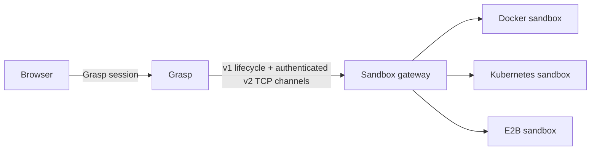

# sandbox-gateway contract

Grasp vendors [sandbox-gateway](sandbox-gateway/) in this repository. The
control plane creates and destroys sandboxes. Grasp can use the returned
endpoints directly, or carry SSH, HTTP and WebSocket traffic through an
authenticated gateway connection for Docker, Kubernetes and E2B.

For operator configuration, see [Grasp and sandbox configuration / defaults
(中文)](CONFIGURATION.md): supported keys, environment overrides, Docker/Kubernetes
resource defaults, E2B template fields and the current minimum connection setup.

Source layout:

- `sandbox-gateway/gateway/` — Go control plane
- `sandbox-gateway/sandbox/` — universal sandbox image (environment only) and
  the source of the sandbox runtime bundle (scripts, `cmd/`, `internal/`, `web/`)
- `scripts/build-sandbox-runtime.sh` — builds the runtime bundle the Grasp
  server ships and serves to sandboxes
- `sandbox-gateway/deploy/config/config.local.yaml` — local compose config

Deployment guides: [Docker](sandbox-gateway/deploy/docker/README.md),
[Kubernetes](sandbox-gateway/deploy/k8s/README.md),
[E2B](sandbox-gateway/deploy/e2b/README.md). They cover configuration injection,
network access, persistent data, upgrades and acceptance checks. Kubernetes
includes a complete single-replica example; the older `pods/log` manifests
are incremental permissions only.

## Local stack

From the repo root (Linux host with Docker Compose):

```bash
./start.sh -d          # default: published GHCR images (compose.release.yaml)
./start.sh dev -d      # source/HMR stack (docker-compose.yml)
```

Two paths, different UI ports:

| Mode | Command | Gateway | API | UI |
| --- | --- | --- | --- | --- |
| Release (default) | `./start.sh -d` | `:8899` | `:8080` | `:8080` (served with the API) |
| Dev / source | `./start.sh dev -d` | `:8899` | `:8080` | `:5173` (Vite) |

Release mode ensures Grasp + Gateway images when missing; the sandbox runtime
pulls on first create (`status=pulling`). Use `./start.sh pull` to warm it.
Dev mode may build `universal-sandbox:local` from `sandbox-gateway/sandbox`
on first run (slow).

## E2B deployment

`driver: e2b` is an independent opt-in deployment alongside Docker and Kubernetes.
It implements this gateway API with prepared E2B templates and private loopback
TCP tunnels, so Grasp keeps using SSH, ACP, IDE and browser protocols. Legacy
direct mode requires Grasp and the gateway in the same Linux network namespace.
The opt-in gateway transport below removes that requirement; only the gateway
needs access to its provider endpoints. Browser clients use Grasp proxies,
including the existing `/preview/...` path proxy. The dedicated
[deployment guide](sandbox-gateway/deploy/e2b/README.md) covers template profiles,
callback routing, credentials, leases and recovery. `compose.e2b.yaml` does not
change either existing startup path.

Private-network egress requires configuration on the E2B provider. A gateway
that can reach an internal service does not grant its guests the same access.
For supported self-hosted versions, set `ALLOW_SANDBOX_INTERNAL_CIDRS` on the
provider's orchestrator, preserving existing entries. See
[private-network setup and verification](sandbox-gateway/deploy/e2b/README.md#内网访问)
for the deployment-file location, node-wide scope and rollout checks.

E2B template CPU/memory and minimum initial available workspace capacity must
match a configured profile; disk capacity is not a resizable PVC or hard quota.
The gateway Stop/Start operations explicitly pause/resume with memory; provider
routing must pass readiness again. New E2B guests default to `e2b.autoPause: true`
(`SBGW_E2B_AUTO_PAUSE`): expiry pauses with a memory snapshot instead of killing
the guest. Existing guests retain their creation policy. Provider auto-resume
is disabled; Grasp explicitly resumes paused Solo sandboxes on next use. Grasp
Stop still destroys its sandbox. Reinstall with `preserveData=true` reports an
unsupported operation; snapshot migration is outside this gateway contract.

## Gateway transport and multiple deployments

`sandbox.gateway_transport: gateway` opts into the authenticated v2 data
channel. The default remains `direct`, so existing Docker/Kubernetes installs
and old v1 gateways keep their current behavior. Upgrade gateways before
enabling the new transport in Grasp. It requires a configured gateway API key;
an anonymous v1 gateway cannot expose the v2 channel.



Each gateway deployment still runs **one** driver. The three arrows represent
three independent deployments, not a multi-driver gateway. Grasp shares one
connection registry across workflow execution, Solo and Studio. SSH execution,
file transfer, terminal, chat/history, code-server, browser CDP and noVNC keep
their existing application protocols and credentials. The adapter listens on
Grasp's loopback only; these local endpoint addresses are for the server. The
browser continues using Grasp's existing links and session authorization.

For a single existing gateway, set `GRASP_SANDBOX_GATEWAY_TRANSPORT=gateway`
and `GRASP_SANDBOX_GATEWAY_API_KEY`. Gateway transport automatically marks
endpoints private for every driver: previews are served through the Grasp
`/preview/...` path proxy and no extra preview domain is needed.
`server.mcp_advertise` must remain reachable **from inside the sandbox** for
runtime/config bundles, artifacts, MCP and callbacks; the data tunnel does not
replace that route.

For migration between providers, retain the legacy URL and add stable named
connections to the Grasp YAML:

```yaml
server:
  public_advertise: https://grasp.example.com
  mcp_advertise: https://grasp.example.com
sandbox:
  # Original gateway for existing, unqualified sandbox IDs. Do not repoint it.
  gateway_url: https://gateway-docker.example.test
  # Supply its key through GRASP_SANDBOX_GATEWAY_API_KEY.
  gateway_transport: gateway
  gateways:
    - id: docker-v1
      url: https://gateway-docker.example.test
      api_key_env: DOCKER_GATEWAY_KEY
      transport: gateway
      profile: universal
    - id: e2b-v1
      url: https://gateway-e2b.example.test
      api_key_env: E2B_GATEWAY_KEY
      transport: gateway
      profile: universal
  default_gateway: e2b-v1
```

The same configuration accepts a Kubernetes gateway. Add only live gateway
deployments. A fresh single-provider installation can use the same URL for
the legacy entry and its named entry. Keys stay on Grasp/gateway servers and
are not passed to browser URLs or sandbox environment variables.

Named connections default to `gateway` transport; explicit `direct` remains
available. Their IDs are permanent routing keys. New sandbox IDs encode that
key and the provider's native ID; the native ID alone is sent to its owning
gateway. The `grasp.gateway.id` label preserves that binding during list and
reconciliation, including gateways sharing the same legacy URL. Do not rename
or repoint a connection while its sandboxes exist. Apply connection/default
changes with a Grasp restart; `GRASP_SANDBOX_DEFAULT_GATEWAY` overrides the
YAML default. Existing sandboxes keep their original connection; only newly
created sandboxes use the new default. Workspaces are not copied or migrated.
To roll back a provider choice, select the previous default while retaining
all in-use connections. Older Grasp binaries do not understand qualified IDs;
do not downgrade the application while those sandboxes are still in use.

Startup waits for v2 discovery before reconciliation. An incomplete gateway
inventory fails conservatively; it must not trigger orphan deletion. Removing
an in-use binding or losing its gateway produces a connection error rather
than falling back to a saved local port. On restart Grasp resolves new local
listeners from sandbox IDs instead of reusing persisted port numbers.

Optional environment profiles belong to the selected backend. For Docker:

```yaml
driver: docker
docker:
  image: universal-sandbox:local
  profiles:
    universal:
      image: universal-sandbox:local
```

Kubernetes uses `kubernetes.profiles`. E2B automatically advertises the names
under `e2b.templates`; it needs no separate profile-to-image map. One E2B
template is selected automatically, while multiple templates require
`e2b.defaultTemplate`. A Grasp named connection can select one with `profile`.
This selects an environment, not an Agent/coding tool.

Grasp leaves its image unset and memory override at `0` by default. The gateway
fills resources from the **selected** template or its Docker/Kubernetes defaults.
An explicit E2B resource override must match that template exactly. Docker/K8s
requests must stay within the backend's `resources.max`. Unknown profiles and
conflicting image overrides fail before provisioning. Runtime bundles still
ship with Grasp; sandbox logic changes do not require a new environment image.

Discovery reports actual lifecycle/storage semantics: Docker cold stop with
no disk quota, Kubernetes cold stop with PVC storage, E2B memory pause with
template minimum initial free space. This transport does not turn a cold stop
into memory pause or add disk quotas/reinstall guarantees. Existing Grasp
Stop/retention behavior is unchanged. GitLab deployment jobs and E2B template
build automation are separate from this opt-in application change.

## Minimum compatible API

| Capability | Contract |
| --- | --- |
| Health | `GET /healthz` returns 2xx |
| Create | `POST /api/v1/sandboxes` accepts image, env, labels, ports, resources, config.bundleUrl; response `202`, status `creating` then optionally `pulling` while the image downloads, then `creating` again during `docker run` / finalize |
| Get | `GET /api/v1/sandboxes/{id}` returns status and endpoints. Gateway still includes internal `cdp`/`novnc` (container/ClusterIP) for in-cluster Grasp. Grasp user `GetView` only returns `session`/`ide`/`ssh`. |
| List | `GET /api/v1/sandboxes?label=key:value` (AND) |
| Delete | `DELETE /api/v1/sandboxes/{id}` returns 2xx |
| Logs | `GET /api/v1/sandboxes/{id}/logs?tail=` returns `{content}` (PID1 stdout/stderr, non-follow). Docker (`docker logs --tail`) and kubernetes (pod `sandbox` container via client-go GetLogs) both supported. Cluster RBAC must allow `get` on `pods/log` in the sandbox namespace; the incremental Role+RoleBinding is shipped in `sandbox-gateway/deploy/k8s/` (apply alongside existing Roles — do not replace a full production Role). Drivers that still omit Logs → `501` |
| Ready | status `running` with a `session` endpoint |
| Images | one image `universal-sandbox` (six CLIs, including Codex, which uses a login file rather than an API key); runtime `AGENT_PROVIDER` selects the live CLI |
| Runtime bundle | the image holds only the environment plus `/grasp-bootstrap.sh` (entrypoint). Grasp passes `GRASP_RUNTIME_URL` (Bearer from `SANDBOX_INJECT_HEADERS`) in the create env; the bootstrap installs that bundle and runs its `startup.sh`. Without it the container exits 1. Running sandboxes are updated over SSH (`grasp-bootstrap.sh install-stdin` + `services.sh restart`). Exit 4 = the bundle needs a newer image (`/etc/grasp-image-level` < MANIFEST `min_image`). Deploy the Grasp server before a new sandbox image. |
| Data plane | Legacy SSH / session / ide can connect directly (each has its own auth); optional v2 channels carry all services through the owning gateway. CDP/noVNC remain private. Grasp outside the provider network uses gateway transport. Browser users keep `/sandbox-vnc/:id/ws` and the existing session checks. |
| Optional v2 | Authenticated `GET /api/v2/info` advertises protocol, ports, profiles and capabilities. `GET /api/v2/sandboxes/{nativeID}/connect/{guestPort}` upgrades to `grasp-tcp-v1`. Reverse proxies must forward WebSocket upgrades and allow long connections. See the [wire contract](sandbox-gateway/gateway/docs/API.md#authenticated-tcp-transport-v2). |
| Auth | Bearer token: gateway `SBGW_API_KEYS` / client `GRASP_SANDBOX_GATEWAY_API_KEY` (compose default `grasp-local-demo` via `SANDBOX_GATEWAY_API_KEY`) |

`grasp doctor --run-demo` verifies health, create, ready, and cleanup after failure.

## Published images

Release tags may also publish digest-pinned images to `ghcr.io/cocofhu/...`.
`compose.release.yaml` still requires explicit immutable references for the
clean-Linux smoke path.
