<div align="center">

<picture>
  <source media="(prefers-color-scheme: dark)" srcset="media/logo-dark.svg">
  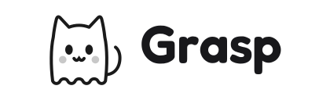
</picture>

<h3>From one sentence to an approved pull request.</h3>

<p>Self-hosted workspace that runs coding agents in sandboxes, on workflows you can see,<br/>with clarification up front and human approval before anything ships.</p>

[](https://github.com/cocofhu/grasp/releases)
[](LICENSE)
[](server/go.mod)
[](web/package.json)
[](#deployment)
[](https://github.com/cocofhu/grasp/stargazers)

[](https://github.com/cocofhu/grasp/actions/workflows/ci-server.yml)
[](https://github.com/cocofhu/grasp/actions/workflows/ci-web.yml)
[](https://github.com/cocofhu/grasp/actions/workflows/ci-sandbox.yml)
[](https://github.com/cocofhu/grasp/actions/workflows/ci-gateway.yml)

<a href="https://trendshift.io/repositories/95319" target="_blank"></a>

**English** · [简体中文](README.zh-CN.md)

[Website](https://www.approving-ai.com/) ·
[Two ways to work](#two-ways-to-work) ·
[Quick start](#quick-start) ·
[Workflows](#how-workflows-work) ·
[Features](#features) ·
[FAQ](#faq) ·
[Docs](#documentation)

</div>

<p align="center">
  <a href="media/grasp-readme-video.mp4">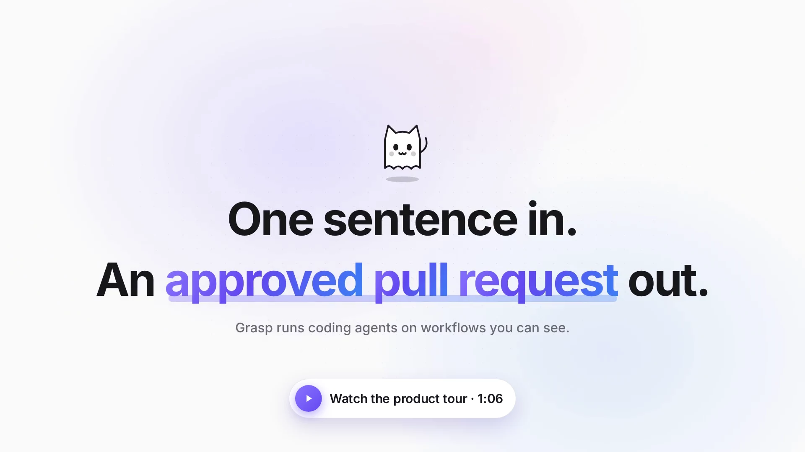</a>
</p>

<p align="center"><sub>Product tour (1:06, 1080p 60 fps, no sound): one sentence in; a workflow that clarifies, implements, rolls back on failing tests and waits for your approval; any coding agent in its own sandbox; Solo, artifacts and token cost.</sub></p>

**Grasp** is a self-hosted workspace for shipping software with coding agents. Describe a task in one sentence and run it as a **workflow** (a multi-step pipeline on a finite-state-machine canvas, with clarification, implementation, tests and human gates) or as a **Solo session** (one agent in its own sandbox). Either way, agents ask questions as clickable cards and hand back structured artifacts and live page previews instead of walls of text.

Coding-agent CLIs do the work: **Cursor, Claude Code, Codex, CodeBuddy, Trae, OpenCode, DeepSeek Harness and Kimi Code**. Grasp adds the canvas, sandboxes (Docker, Kubernetes or E2B), approvals and history around them, on your own infrastructure under the MIT license.

<p align="center">
  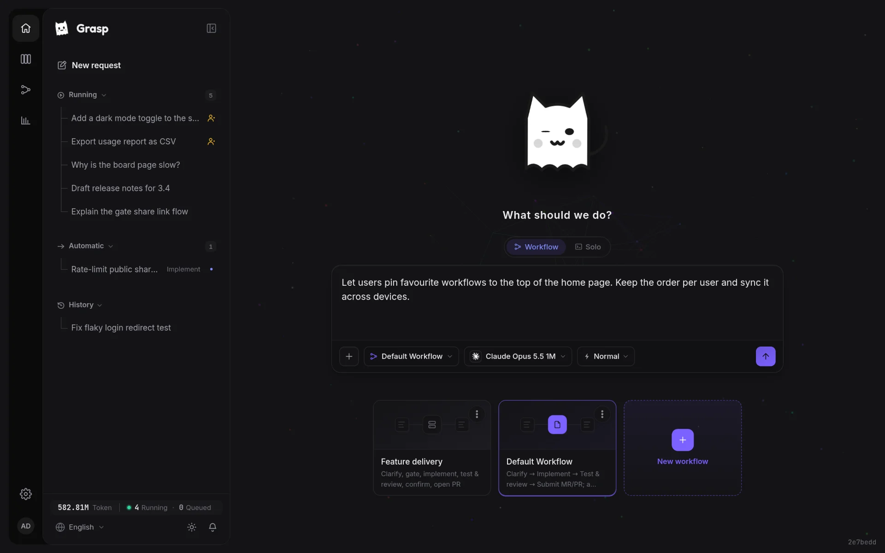
</p>

<p align="center"><sub>The home page. Type a request, pick a workflow or switch to Solo, and choose the model. Every session stays in the sidebar, so you always know what is running and where it stopped.</sub></p>

## Two ways to work

| | **Run a workflow** | **Start a Solo session** |
| --- | --- | --- |
| Best for | Repeatable delivery with fixed stages, tests and sign-off | Exploring, debugging, one-off changes |
| How it runs | The FSM engine walks agent, branch and human-gate nodes along explicit `success` / `failure` / `rollback` edges; the nodes of a run share one sandbox | One agent in its own sandbox with an IDE, terminal and browser; idle sandboxes are saved and resumed on your next message |
| You stay in control by | Answering clarification cards, approving at gates or sending work back, sharing a one-time review link with people who have no account | Answering the agent's question cards and steering the chat |
| Delivers | Spec, plan, page mock, test results, review and a PR / MR | Code changes, artifacts and previews in the side panel |

Both modes share the same agents, credentials, artifact panel and token accounting.

## Why Grasp

Over the past two years I built 150+ personal projects with coding agents, and two problems kept slowing me down: **switching between projects** (which IDE is running what, and where did it stop?) and **reviewing agent output** (the actual changes and open questions buried in long chat logs). Grasp is the workspace I wanted:

- **Clarify before coding.** A clarify agent asks one question at a time, with a recommended answer, then writes a spec, a plan and a clickable `page.html` mock you can annotate.
- **Explicit, versioned workflows.** Every step and transition is on the canvas. A failed test goes back to implementation because an edge says so, not because the model remembered to.
- **Human in the loop.** Gates pause the run until someone reads the artifacts and approves or sends the work back.
- **Structured output, not prose.** Specs, plans, test results, reviews and HTML previews are versioned artifacts. A node can't finish until it submits the ones it declares as required.
- **Your stack, your servers.** Eight agent CLIs, per-repository Git credentials, and Docker, Kubernetes or E2B sandboxes. Credentials are stored in the workspace and injected per run.

## Quick start

Requirements: a **Linux** host with Git, Docker and Docker Compose (services use host networking).

```bash
git clone https://github.com/cocofhu/grasp.git
cd grasp
./start.sh -d
```

`./start.sh` pulls the published GHCR images, so nothing is built locally. Once it is up:

| | |
| --- | --- |
| Web UI / API | <http://localhost:8080> |
| API health | <http://localhost:8080/api/health> |
| Gateway health | <http://localhost:8899/healthz> |
| Default login | `admin` / `demo1234` (local evaluation only) |

The sandbox runtime image is pulled when the first sandbox is created, or ahead of time with `./start.sh pull`.

> [!IMPORTANT]
> This release requires a fresh install: an empty database and an empty data directory.

### What you need

| I want to… | You need |
| --- | --- |
| Look around the workspace and the canvas | Nothing beyond the quick start |
| Run a workflow or a Solo session | A credential for one coding tool: an API key, a model service key, or a ChatGPT `~/.codex/auth.json` for Codex |
| Have agents push branches and open PRs / MRs | A Git repository plus a credential for `gh`, `glab` or SSH |

### Your first run

1. **Sign in.** The first visit opens the setup wizard: preferences, credentials, coding tool and model, Git (optional), and the agent team. It previews the default workflow, `Clarify → Implement → Test & review → Deliver`, before publishing it.

   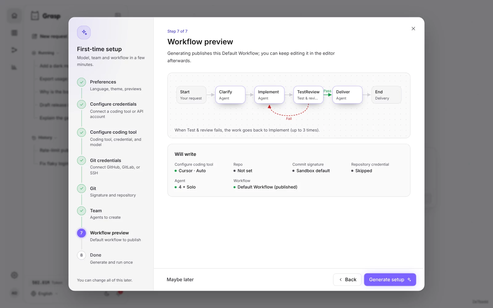

2. **Start a run** from the home page with a single prompt, or switch to **Solo**.
3. **Answer the clarify cards** and check the spec and page mock.
4. **Review at the gate:** read the test results, review and diff, then approve or send it back.

<details>
<summary><b>More setup details</b>: credentials, commands, bundled roles</summary>

<br>

- **Credentials and models.** In **Settings → Credentials**, save a tool platform credential or a model service key with a preset or custom API base. In the **Models** tab, save a named combination of coding tool, credential and model, then pick it in Agent Studio. Third-party protocols are filtered by what each tool supports; Codex accepts a ChatGPT login file or a Responses connection.
- **Common commands.**

  ```bash
  ./start.sh logs        # follow logs
  ./start.sh gw-logs     # gateway logs only
  ./start.sh restart     # restart in background
  ./start.sh down        # stop and remove containers
  ./start.sh pull        # update service images and pre-pull sandbox runtime
  ./start.sh dev -d      # run source stack (Go + Vite HMR)
  ```

  Image tags and digests can be overridden in `.env`; see [`.env.example`](.env.example).
- **Bundled role agents.** `agents/` contains `ClarifyAgent`, `ImplementAgent`, `TestReviewAgent` and `DeliverAgent`. Run `./agents/pack.sh` (or `./agents/pack.sh ClarifyAgent`) to build ZIPs in `agents/dist/`, then import them in Agent Studio. ZIP import defaults `acpBackend` to `cursor`; change the backend in the UI if needed.

</details>

## How workflows work

A workflow is a finite-state machine. Agents and people take part in the same run, and every transition is an edge you can see:

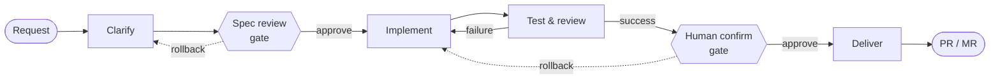

<p align="center">
  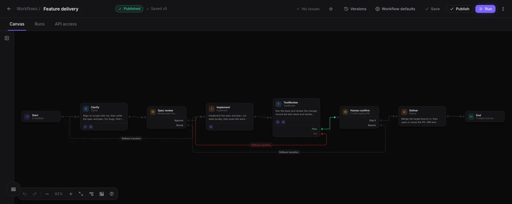
</p>

<p align="center"><sub>The same workflow on the canvas. Each agent node picks a role; failure and rollback edges send work back to an earlier step.</sub></p>

| Node | What it does |
| --- | --- |
| **Input / Output** | Where the request enters and the result leaves the workflow. |
| **Agent** | Runs a role (backend, model, `AGENTS.md` rules and skills) in a sandbox to clarify, implement, test, review or deliver. |
| **Human gate** | Pauses the run until someone checks the artifacts and approves, or sends the work back. |
| **Branch** | Routes on a condition over run variables. |
| **Set variable** | Writes values that later `when` guards and prompts can read. |

Edges are `success`, `failure` or `rollback`, optionally guarded by `when` expressions. A rollback restores the run variables saved at a checkpoint node, carries the error context back, and counts against an attempt cap. All nodes of a run share one sandbox, so the workspace and uncommitted changes carry over. Workflows are versioned and published from the canvas.

## Features

| Area | What you get |
| --- | --- |
| **Visual clarification** | One question at a time as option cards with a recommended answer; a structured spec and plan; a clickable `page.html` mock for desktop and mobile, with element annotations sent back as feedback. |
| **FSM canvas** | Input, output, set-variable, branch, agent and human-gate nodes; `success` / `failure` / `rollback` edges, `when` guards, checkpoints, version history and publishing. |
| **Solo sessions** | A one-off agent chat with its own sandbox, IDE, terminal and browser, sharing the question cards and artifact panel with workflows. |
| **Structured artifacts** | Specs, plans, test results, reviews and HTML previews submitted through Artifact MCP and versioned per run; required artifacts gate node completion. |
| **Human gates** | Approve or rework from the run page; reviewers without an account can use a one-time share link. |
| **Git delivery** | Agents push branches and open PRs / MRs via `gh`, `glab` or SSH, with a credential per repository. |
| **Agent Studio** | Reusable roles with a backend, model, rules and skills, grouped into teams and shared across workflows. |
| **Observability & cost** | State timeline, node handoff notes, sandbox logs, and token / cost tracking by workflow, source and model. |
| **Sandboxes** | Docker, Kubernetes or E2B through one gateway; idle sandboxes are saved and released automatically. |

<p align="center">
  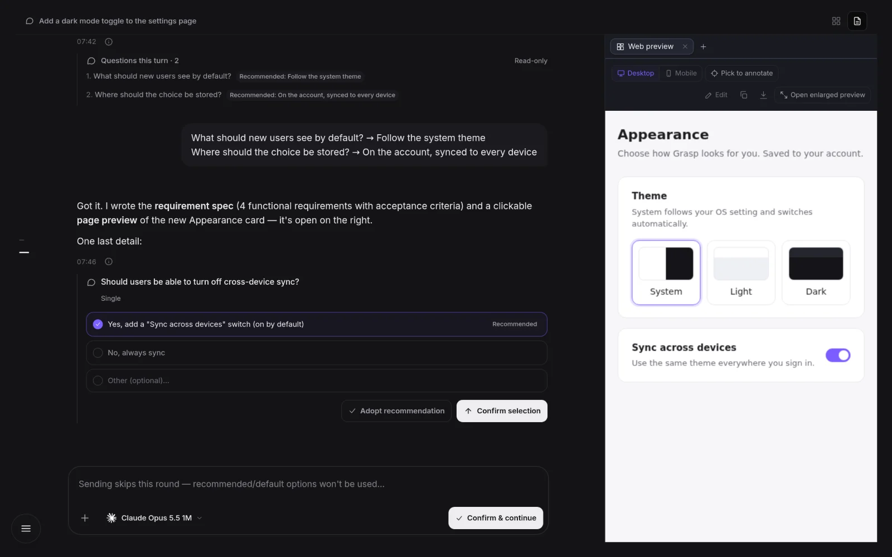
</p>

<p align="center"><sub>Clarification: the agent asks with a recommended answer while the page mock updates beside the chat.</sub></p>

<p align="center">
  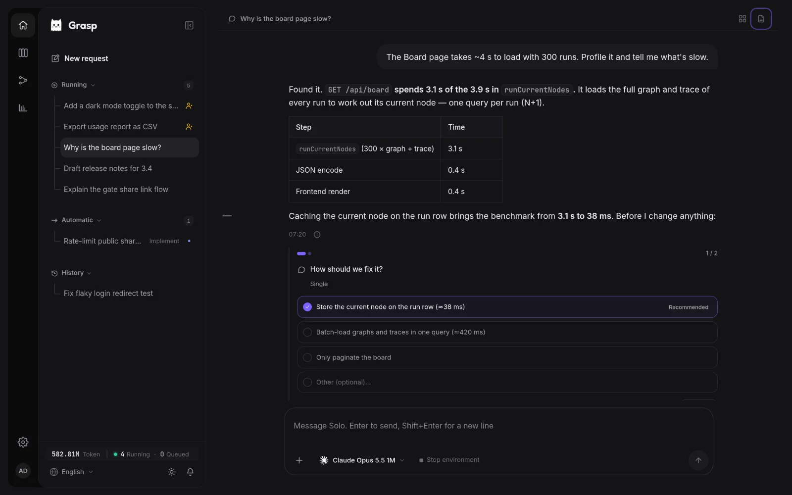
</p>

<p align="center"><sub>A Solo session: the agent profiles a slow page, shows its tool calls, and asks how to fix it.</sub></p>

<table>
  <tr>
    <td width="50%">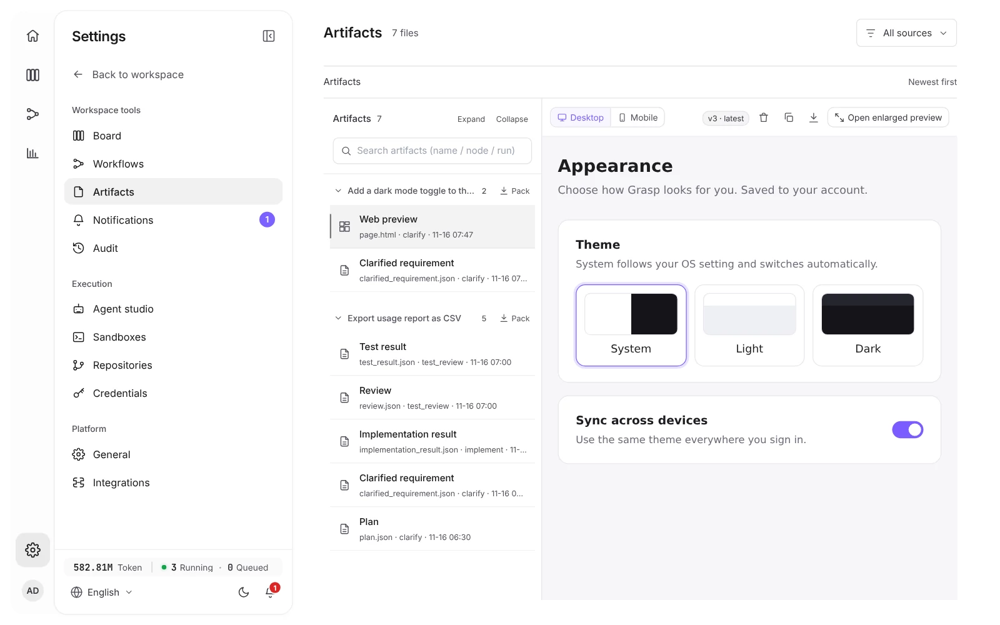</td>
    <td width="50%">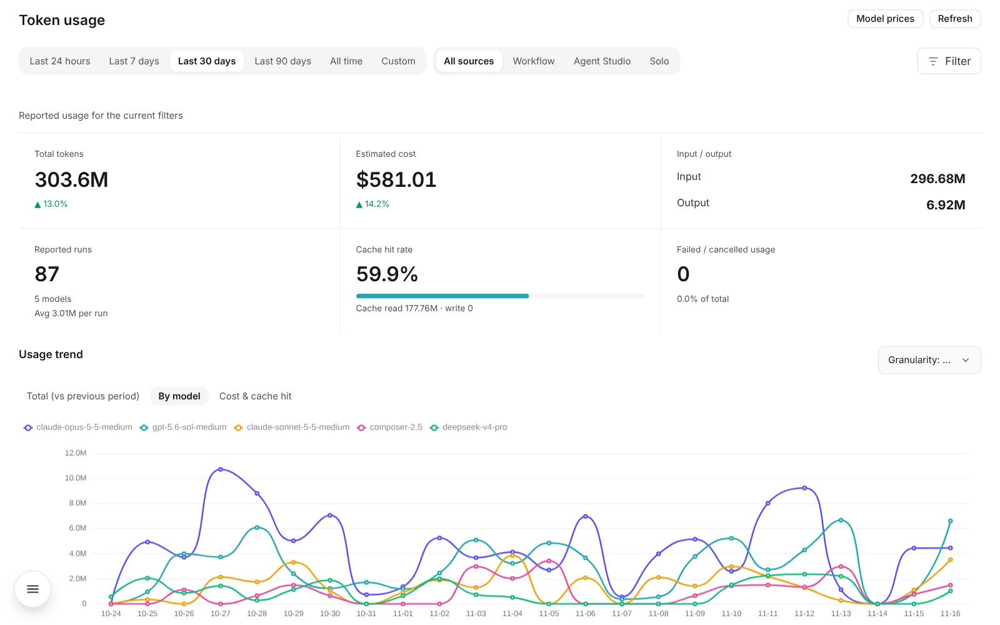</td>
  </tr>
  <tr align="center">
    <td><sub>Artifact library with live HTML preview</sub></td>
    <td><sub>Token usage and cost by model</sub></td>
  </tr>
</table>

## Architecture

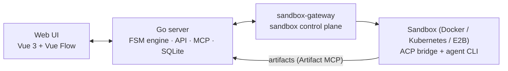

| Directory | Contents |
| --- | --- |
| `web/` | Vue 3 + Vue Flow frontend: home, canvas, clarification, run details, Solo, artifacts, Agent Studio |
| `server/` | Go backend: FSM engine, HTTP API, SQLite, Artifact MCP, audit |
| `sandbox-gateway/` | Sandbox lifecycle control plane (`gateway/`) and the universal sandbox image and runtime (`sandbox/`) |
| `agents/` | Importable role agent workspaces |
| `docs/` | Project website and bilingual help docs |

Configuration precedence is environment variables > mounted config file > code defaults. Runtime secrets (agent API keys, Git tokens, SSH keys) live only in the workspace credentials settings and are injected per run, never read from the server's process environment.

## Deployment

| Target | Guide |
| --- | --- |
| **Docker** | [Docker deployment](sandbox-gateway/deploy/docker/README.md): production Compose overrides, authentication, sandbox callbacks, backups |
| **Kubernetes** | [Kubernetes guide and manifests](sandbox-gateway/deploy/k8s/README.md): namespaces, RBAC, Secrets, PVCs, services, ingress. Uses gateway transport with ClusterIP sandboxes; a per-sandbox LoadBalancer is optional |
| **E2B** | [E2B deployment](sandbox-gateway/deploy/e2b/README.md) with `compose.e2b.yaml`, for E2B Cloud or a compatible self-hosted control plane. Needs prepared environment templates and persistent gateway state |

<details>
<summary><b>Production checklist</b></summary>

<br>

- Store API keys and Git credentials only in the workspace credentials settings; never commit them.
- Pin images by digest; see [Release images and smoke](CONTRIBUTING.md#release-images-and-smoke).
- Behind a reverse proxy, preserve the original `Host` header including a non-default port (nginx: `proxy_set_header Host $http_host`). Share links and the origin check for signed-in requests depend on it. See [SECURITY.md](SECURITY.md).
- Workspace pages refuse iframe embedding. To embed them in a portal, list its origin in `GRASP_FRAME_ANCESTORS`; see [server/CONFIGURATION.md](server/CONFIGURATION.md).
- Back up SQLite (`./.localdata/db`), attachments (`./.localdata/app-data`), gateway state (`./.localdata/gateway`) and the original `GRASP_SECRETS_KEY` and deployment configuration together. For `start.sh` deployments the key is in `.env`. Sandbox workspaces are not in these directories and need separate backups.

</details>

## FAQ

**Do I need an API key?**
Yes, for anything an agent does: one credential for the coding tool you pick (Codex can use a ChatGPT login file instead). Model usage is not included; you bring your own credentials.

**Do I need a Git repository?**
No. Skip the Git step in the wizard and agents work inside the sandbox. Add a repository and credential when you want them to push branches and open PRs / MRs.

**Workflow or Solo?**
Use Solo to explore, debug or make a quick change. When you want every task to follow the same stages, with clarification, tests and sign-off, put it in a workflow.

**How is this different from using Cursor, Claude Code or Codex directly?**
Grasp doesn't replace them; it runs them. Each agent node and each Solo turn is one of those CLIs in a sandbox. Grasp adds what surrounds it: which role does what, in which order, with which checks, who signs off, and a record of every artifact.

**How is this different from Dify, n8n or Flowise?**
Those are general-purpose AI and automation builders. Grasp is built for **software delivery with coding agents**: sandboxes with real repositories, clarification with page mocks, test-and-review loops, human gates and Git delivery.

**Is it safe to expose on the internet?**
Not with the defaults. Replace the demo account, put HTTPS in front, and read [SECURITY.md](SECURITY.md) first. Report vulnerabilities privately through the security policy.

## Documentation

| I want to… | Start here |
| --- | --- |
| Understand the concepts and get running | [Concepts](docs/content/en/guide/concepts.md) · [Quick start](docs/content/en/guide/quick-start.md) |
| Configure Grasp and sandboxes | [Configuration and defaults (中文)](CONFIGURATION.md) · [Environment reference](server/CONFIGURATION.md) |
| Understand the sandbox lifecycle and gateway | [Sandbox lifecycle](docs/content/en/help/sandbox-lifecycle.md) · [Gateway contract](GATEWAY.md) |
| Work on the server | [Server README](server/README.md) |
| Get help or follow releases | [Support](SUPPORT.md) · [Changelog](CHANGELOG.md) · [Security](SECURITY.md) |

## Contributing

Issues and pull requests are welcome: share a use case, report a bug, or improve workflows, agents and the UI. Read [CONTRIBUTING.md](CONTRIBUTING.md), [AGENTS.md](AGENTS.md) and the [Code of Conduct](CODE_OF_CONDUCT.md) for lint, test and E2E commands before submitting changes.

## License

[MIT](LICENSE) © 2026 cocofhu
