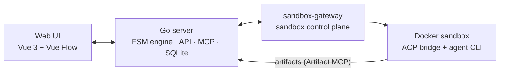

<div align="center">


<h3>Put coding agents into workflows you can approve, and see what they did at a glance</h3>

[](https://github.com/cocofhu/grasp/releases)
[](LICENSE)
[](server/go.mod)
[](web/package.json)
[](https://github.com/cocofhu/grasp/actions/workflows/ci-server.yml)
[](https://github.com/cocofhu/grasp/actions/workflows/ci-web.yml)
[](https://github.com/cocofhu/grasp/actions/workflows/ci-sandbox.yml)
[](https://github.com/cocofhu/grasp/actions/workflows/ci-gateway.yml)

**English** | [简体中文](README.zh-CN.md)

[Website](https://www.approving-ai.com/) · [Quick start](#quick-start) · [Features](#features) · [How it works](#how-it-works) · [Docs](#docs) · [Contributing](#contributing)

<a href="media/grasp-readme-video.mp4"></a>

<sub>▶ 23s · 1080p · silent · real screen recording: login → first-run wizard → workflow canvas → home → Agent Studio</sub>

</div>

## What is Grasp

I've built 150+ side projects over the last two years, and two things kept slowing me down:

- **Too many projects at once**: jumping between IDEs, trying to remember what's running and where it got to.
- **Agent output is hard to read**: walls of text with the important bits buried somewhere in the middle.

Grasp is my fix. It keeps every project in one place and wires agents into workflows on a finite-state-machine (FSM) canvas. Requirements get clarified visually, agent output becomes structured artifacts, and key steps stop and wait for a human. Agents can move fast; people still own the decisions.

Supported backends: **Cursor, Claude Code, CodeBuddy, Trae, OpenCode, Codex**. Agents run inside Docker sandboxes.

## Full demo

https://github.com/user-attachments/assets/47728d1f-54a1-485e-967e-28d8c716ed36

## Features

### Orchestration

| Feature | Details |
|---|---|
| FSM canvas | Six node types: agent, input, output, assign, branch, human gate. Edges for success / failure / rollback, plus `when` guards and checkpoints |
| Built-in templates | Clarify → Implement → Test & review; a failed review loops back to Implement |
| One-line start | Type a sentence on the home page to start a run |
| Parallel runs | Many runs at once, all approvals in one inbox |

### Human in the loop

| Feature | Details |
|---|---|
| Visual clarification | A clarify agent talks it through with you and writes a spec, a plan, and an optional `page.html` preview |
| Human gates | Runs pause at a gate until you approve or reject, from the inbox or run details |
| Temporary approval links | One-time links that open the same review screen for people without an account |
| Structured artifacts | Artifacts are scoped per run (Artifact MCP); a missing required artifact fails the node |

### Execution and delivery

| Feature | Details |
|---|---|
| Docker sandboxes | Each agent runs isolated; the runtime is pulled on first use |
| Git delivery | `gh` / `glab` / SSH inside the sandbox to open PRs / MRs |
| Observability | Timeline, sandbox logs, artifacts, token usage and cost |
| Agent Studio | Manage agents, backends and credentials; import the role agents in `agents/` |

<table>
  <tr>
    <td></td>
    <td></td>
    <td></td>
  </tr>
  <tr align="center">
    <td><sub>Artifact review</sub></td>
    <td><sub>Agent Studio</sub></td>
    <td><sub>Token usage</sub></td>
  </tr>
</table>

## Quick start

You need a **Linux** host with Git, Docker and Docker Compose (services use host networking).

```bash
git clone https://github.com/cocofhu/grasp.git
cd grasp
./start.sh -d
```

This pulls the published GHCR images, so there's nothing to build. Then open:

| URL | What |
|---|---|
| <http://localhost:8080> | UI / API |
| <http://localhost:8080/api/health> | API health |
| <http://localhost:8899/healthz> | Gateway health |

The local demo login is `admin` / `demo1234`. Use your own users for anything shared or in production.

> The sandbox runtime is pulled the first time you create a sandbox. Run `./start.sh pull` to warm it up ahead of time.

### Your first workflow

1. Log in with the demo account. A fresh install is empty, with no sample workflow.
2. In **Agent Studio**, create an agent, pick `cursor`, `claude_code`, `codebuddy`, `trae`, `opencode` or `codex`, and add its API key. Codex uses the ChatGPT login file (`~/.codex/auth.json`) instead of an API key.
3. Open the canvas. Start from the default template, or drag agents and gates in from the left and wire up success, failure and rollback edges.
4. Publish and start a run (or start one from the home page), then watch the inbox for gates.

### Handy commands

```bash
./start.sh logs        # follow logs
./start.sh gw-logs     # gateway logs only
./start.sh restart     # restart, detached
./start.sh down        # stop
./start.sh pull        # refresh images and the sandbox runtime
./start.sh dev -d      # source stack: Go + Vite HMR
```

Override image tags / digests in `.env`; see [`.env.example`](.env.example).

### Import the bundled role agents

`agents/` ships five roles: PMAgent, ClarifyAgent, ImplementAgent, TestReviewAgent and DeliverAgent.

```bash
./agents/pack.sh               # pack all into agents/dist/
./agents/pack.sh ClarifyAgent  # just one
```

Import the ZIPs in Agent Studio. ZIP import doesn't keep `acpBackend` yet, so imported agents start on `cursor`; change it afterwards if needed.

## How it works



A typical delivery flow, with failure and rollback edges on the same canvas:

```text
Clarify → Research → Human gate
        → Plan → Implement → Test → Review
        → Human confirm → PR / MR
```

| Path | What's inside |
|---|---|
| `web/` | Canvas, home-page clarification, run details, inbox, Agent Studio |
| `server/` | FSM engine, API, SQLite, Artifact MCP, scheduling and audit |
| `sandbox-gateway/` | Sandbox lifecycle control plane (`gateway/`) and the universal sandbox image (`sandbox/`) |
| `agents/` | Importable role agents |
| `docs/` | Project site and zh/en help docs |

Config precedence: environment variables > mounted config file > code defaults.

## Before you deploy

- Set API keys and Git credentials only in the project credentials UI; never commit them.
- Pin images by digest in production; see [Release images and smoke](CONTRIBUTING.md#release-images-and-smoke).
- Behind a reverse proxy, keep the original `Host` (e.g. nginx `proxy_set_header Host $host`); temporary approval links are built from it. See [SECURITY.md](SECURITY.md).
- SQLite (`./.localdata/db`) and attachments (`./.localdata/app-data`) are mounted separately. Back them up and clean them together, or runs can end up pointing at `blob:` IDs that 404.

## Docs

- [Concepts](docs/content/en/guide/concepts.md) · [Quick start](docs/content/en/guide/quick-start.md)
- [Configuration](server/CONFIGURATION.md) · [Server](server/README.md) · [Gateway contract](GATEWAY.md)
- [Security](SECURITY.md) · [Support](SUPPORT.md) · [Changelog](CHANGELOG.md)

## Contributing

Issues and PRs are welcome. Have a look at [CONTRIBUTING.md](CONTRIBUTING.md), [AGENTS.md](AGENTS.md) and the [Code of Conduct](CODE_OF_CONDUCT.md) first; lint, test and E2E commands for each module live there.

<a href="https://trendshift.io/repositories/95319" target="_blank"></a>

## License

[MIT](LICENSE) © 2026 cocofhu
