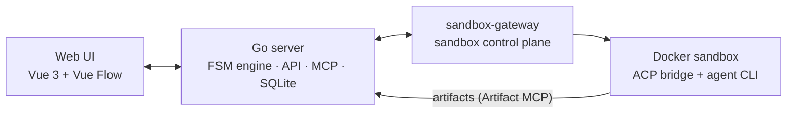

<div align="center">


<p>Coding agent workflow orchestration with human approval gates in one workspace</p>

[](https://github.com/cocofhu/grasp/releases)
[](LICENSE)
[](server/go.mod)
[](web/package.json)
[](https://github.com/cocofhu/grasp/actions/workflows/ci-server.yml)
[](https://github.com/cocofhu/grasp/actions/workflows/ci-web.yml)
[](https://github.com/cocofhu/grasp/actions/workflows/ci-sandbox.yml)
[](https://github.com/cocofhu/grasp/actions/workflows/ci-gateway.yml)

**English** | [简体中文](README.zh-CN.md)

[Website](https://www.approving-ai.com/) · [Quick start](#quick-start) · [Features](#features) · [Architecture](#architecture) · [Docs](#docs) · [Contributing](#contributing)

<a href="media/grasp-readme-video.mp4"></a>

</div>

## Why Grasp

Over the past two years I built 150+ personal projects with coding agents, and two problems kept slowing me down:

1. **Switching across projects is expensive**: bouncing between IDEs makes it hard to track which project is running and where it stopped.
2. **Parallel agent output is hard to read**: models dump long walls of text, burying the actual changes and open questions in chat logs.

I built Grasp to manage coding work in one workspace. It wires coding agents into workflows on a finite-state-machine (FSM) canvas, clarifies requirements before code is written, and turns verbose agent output into structured artifacts and visual previews that are quick to review at approval gates.

Supported agent backends: **Cursor, Claude Code, CodeBuddy, Trae, OpenCode, and Codex**. Each agent step runs inside an isolated Docker sandbox.

## Demo

https://github.com/user-attachments/assets/47728d1f-54a1-485e-967e-28d8c716ed36

## Features

- **FSM workflow canvas**: Six node types (agent, input, output, assign, branch, human gate), with explicit `success`, `fail`, and `rollback` edges, `when` guards, and checkpoints.
- **Visual requirement clarification**: Start a task from the home page with one sentence. A clarify agent aligns on scope through multi-turn Q&A and produces a structured spec, execution plan, and optional `page.html` preview.
- **Human gates and unified inbox**: Runs pause at gate nodes for approval or rejection from a single inbox; one-time share links let reviewers without an account inspect and approve.
- **Structured artifacts (Artifact MCP)**: Artifacts are isolated per run. Nodes must submit their declared required artifacts before the engine transitions forward.
- **Docker sandboxes and Git delivery**: Agents run in isolated containers and can push branches or open PRs / MRs via `gh`, `glab`, or SSH.
- **Observability**: State transition timeline, node handoff notes, sandbox logs, live desktop preview (noVNC), and token / cost tracking by workflow, source, and model.

<table>
  <tr>
    <td></td>
    <td></td>
  </tr>
  <tr align="center">
    <td><sub>Workflow canvas</sub></td>
    <td><sub>Artifact review</sub></td>
  </tr>
  <tr>
    <td></td>
    <td></td>
  </tr>
  <tr align="center">
    <td><sub>Agent Studio</sub></td>
    <td><sub>Token usage</sub></td>
  </tr>
</table>

## Quick start

Requirements: a **Linux** host with Git, Docker, and Docker Compose (services use host networking).

```bash
git clone https://github.com/cocofhu/grasp.git
cd grasp
./start.sh -d
```

This pulls the published GHCR images without building locally. Once started:

- Web UI / API: <http://localhost:8080>
- API health: <http://localhost:8080/api/health>
- Gateway health: <http://localhost:8899/healthz>

The default login is `admin` / `demo1234` (for local evaluation only; configure your own users for shared or production setups). The sandbox runtime image is pulled on first sandbox creation, or ahead of time with `./start.sh pull`.

### Running your first workflow

1. Sign in with the demo account. Opening the workspace for the first time launches the setup wizard.
2. In the wizard (or **Project Credentials**), select `cursor`, `claude_code`, `codebuddy`, `trae`, `opencode`, or `codex`, and save the corresponding API key (`codex` uses your `~/.codex/auth.json` login file instead of an API key; Git credentials are optional). Finishing the wizard creates the default agent team and publishes the default workflow (`Clarify → Implement → Test & review`).
3. Start a run from the home page with a single prompt, or open the canvas to customize nodes and `success` / `fail` / `rollback` edges.
4. When a run pauses at a human gate, review the spec, preview page, or code diff from the inbox to approve or reject.

### Common commands

```bash
./start.sh logs        # follow logs
./start.sh gw-logs     # gateway logs only
./start.sh restart     # restart in background
./start.sh down        # stop and remove containers
./start.sh pull        # update service images and pre-pull sandbox runtime
./start.sh dev -d      # run source stack (Go + Vite HMR)
```

Image tags and digests can be overridden in `.env`; see [`.env.example`](.env.example).

### Bundled role agents

`agents/` includes five prebuilt roles: `PMAgent`, `ClarifyAgent`, `ImplementAgent`, `TestReviewAgent`, and `DeliverAgent`.

```bash
./agents/pack.sh               # pack all into agents/dist/
./agents/pack.sh ClarifyAgent  # pack a single role
```

Import the generated ZIPs in Agent Studio. ZIP import currently defaults `acpBackend` to `cursor`; update the backend in the UI after importing if needed.

## Architecture



Typical delivery workflow (with failure and rollback paths defined on the same canvas):

```text
Clarify → Research → Human gate
        → Plan → Implement → Test → Review
        → Human confirm → PR / MR
```

Repository layout:

- `web/` — Vue 3 + Vue Flow frontend (workflow canvas, home clarification, run details, inbox, Agent Studio)
- `server/` — Go backend (FSM engine, HTTP API, SQLite, Artifact MCP, scheduler, audit)
- `sandbox-gateway/` — Sandbox lifecycle control plane (`gateway/`) and universal sandbox image/runtime (`sandbox/`)
- `agents/` — Importable role agent workspaces
- `docs/` — Project website and bilingual help docs

Service configuration precedence: environment variables > mounted config file > code defaults. Runtime secrets (ACP API keys, Git tokens, SSH private keys) are managed exclusively in the workspace credentials settings and injected per run, never from the server's process environment.

## Deployment notes

- Store API keys and Git credentials only in the workspace credentials settings; never commit them to the repository.
- Pin images by digest in production; see [Release images and smoke](CONTRIBUTING.md#release-images-and-smoke).
- Preserve the original `Host` header behind a reverse proxy (e.g. nginx `proxy_set_header Host $host`); temporary approval share links are generated from it. See [SECURITY.md](SECURITY.md).
- SQLite (`./.localdata/db`) and attachments (`./.localdata/app-data`) are mounted separately. Back them up and clean them up together so existing runs do not end up with broken `blob:` references.

## Docs

- [Concepts](docs/content/en/guide/concepts.md) · [Quick start](docs/content/en/guide/quick-start.md)
- [Configuration](server/CONFIGURATION.md) · [Server](server/README.md) · [Gateway contract](GATEWAY.md)
- [Security](SECURITY.md) · [Support](SUPPORT.md) · [Changelog](CHANGELOG.md)

## Contributing

Issues and pull requests are welcome. Please read [CONTRIBUTING.md](CONTRIBUTING.md), [AGENTS.md](AGENTS.md), and the [Code of Conduct](CODE_OF_CONDUCT.md) for module lint, test, and E2E commands before submitting changes.

<a href="https://trendshift.io/repositories/95319" target="_blank"></a>

## License

[MIT](LICENSE) © 2026 cocofhu
