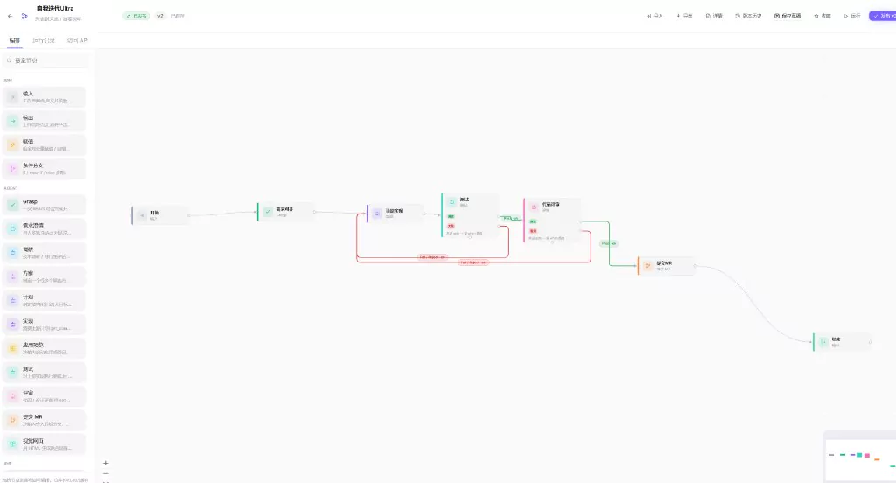
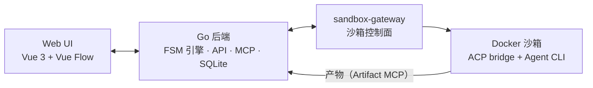

<div align="center">


<p>单工作区 Coding Agent 工作流编排与人工审批平台</p>

[](https://github.com/cocofhu/grasp/releases)
[](LICENSE)
[](server/go.mod)
[](web/package.json)
[](https://github.com/cocofhu/grasp/actions/workflows/ci-server.yml)
[](https://github.com/cocofhu/grasp/actions/workflows/ci-web.yml)
[](https://github.com/cocofhu/grasp/actions/workflows/ci-sandbox.yml)
[](https://github.com/cocofhu/grasp/actions/workflows/ci-gateway.yml)

[English](README.md) | **简体中文**

[项目站](https://www.approving-ai.com/) · [快速开始](#快速开始) · [主要功能](#主要功能) · [系统架构](#系统架构) · [文档](#文档) · [参与贡献](#参与贡献)

<a href="media/grasp-readme-video.mp4"></a>

</div>

当前版本需要全新安装：使用空数据库和空的数据目录。

## 为什么做 Grasp

近两年大模型能力提升很快，我陆续做过 150 多个个人项目，过程中一直卡在两个问题上：

1. **多项目切换成本高**：多个 IDE 来回切，哪个项目在跑、跑到哪一步，很难同时管住；
2. **并行开发时读不懂 Agent 输出**：模型动辄输出大段文本，关键改动和待确认的问题被淹没在对话里，光看懂就要花大量时间。

于是我做了 Grasp：把工作流收进同一个工作区，用有限状态机（FSM）画布编排 Agent 工作流，并通过可视化的需求澄清和结构化产物，把冗长的输出整理成一眼能看懂的内容，减少人工审查的负担。

支持接入 **Cursor、Claude Code、CodeBuddy、Trae、OpenCode、Codex** 等后端，每个 Agent 节点运行在独立的 Docker 沙箱中。

## 演示

https://github.com/user-attachments/assets/47728d1f-54a1-485e-967e-28d8c716ed36

## 主要功能

- **FSM 工作流画布**：包含 Agent、输入、输出、赋值、分支、人工门禁六种节点；支持成功、失败、回滚边，以及 `when` 条件守卫与检查点（Checkpoint）。
- **可视化需求澄清**：从首页输入一句话即可启动任务，澄清 Agent 通过多轮问答对齐需求，产出结构化规格、执行计划及可选的 `page.html` 页面预览。
- **人工门禁与收件箱**：流程到达门禁节点时暂停，可在收件箱或运行详情中集中审批；支持生成一次性临时链接，供未登录协作者直接查看并审批。
- **结构化产物（Artifact MCP）**：产物按运行实例（run）隔离读写，节点完成时自动校验必填产物，缺项直接判定失败。
- **Docker 沙箱与 Git 交付**：每个 Agent 在独立容器内执行，支持在沙箱内通过 `gh`、`glab` 或 SSH 推送分支并创建 PR / MR。
- **运行观测与统计**：记录状态流转时间线、节点交接说明、沙箱日志、实时桌面预览（noVNC），以及按工作流、来源和模型维度的 Token 用量与成本。

<table>
  <tr>
    <td></td>
    <td></td>
  </tr>
  <tr align="center">
    <td><sub>工作流画布</sub></td>
    <td><sub>产物审查</sub></td>
  </tr>
  <tr>
    <td></td>
    <td></td>
  </tr>
  <tr align="center">
    <td><sub>Agent Studio</sub></td>
    <td><sub>Token 用量</sub></td>
  </tr>
</table>

## 快速开始

环境要求：**Linux** 主机，已安装 Git、Docker 和 Docker Compose（服务使用 host 网络模式）。

```bash
git clone https://github.com/cocofhu/grasp.git
cd grasp
./start.sh -d
```

脚本默认拉取 GHCR 已发布镜像，无需本地构建。启动后可访问：

- Web UI / API：<http://localhost:8080>
- API 健康检查：<http://localhost:8080/api/health>
- Gateway 健康检查：<http://localhost:8899/healthz>

默认演示账号为 `admin` / `demo1234`（仅限本地试用，共享或生产环境请配置独立账号）。沙箱镜像会在首次创建沙箱时按需拉取，也可执行 `./start.sh pull` 提前拉取。

### 跑通第一个工作流

1. 使用演示账号登录。首次进入工作区会打开安装向导。
2. 在向导（或「设置 → 凭据」）中选择 `cursor`、`claude_code`、`codebuddy`、`trae`、`opencode` 或 `codex`，填入对应 API Key（Codex 粘贴 `~/.codex/auth.json` 登录文件，无需 API Key；Git 凭据可跳过）。完成后会自动创建默认团队并发布「默认工作流」（需求澄清 → 实现 → 测试评审）。
3. 在首页输入需求直接启动，或打开画布调整节点与成功 / 失败 / 回滚连线后再运行。
4. 流程停在人工门禁时，从收件箱查看澄清结果、预览页面或代码改动，确认后继续流转。

### 常用命令

```bash
./start.sh logs        # 查看日志
./start.sh gw-logs     # 仅查看 Gateway 日志
./start.sh restart     # 重启服务（后台）
./start.sh down        # 停止并移除容器
./start.sh pull        # 更新服务镜像并预拉沙箱镜像
./start.sh dev -d      # 启动源码开发栈（Go + Vite HMR）
```

如需指定镜像版本或 digest，可在 `.env` 中覆盖，参考 [`.env.example`](.env.example)。

### 导入角色包

`agents/` 目录提供了 5 个预置角色：PMAgent、ClarifyAgent、ImplementAgent、TestReviewAgent、DeliverAgent。

```bash
./agents/pack.sh               # 全部打包至 agents/dist/
./agents/pack.sh ClarifyAgent  # 仅打包单个角色
```

打包后可在 Agent Studio 导入生成的 ZIP 文件。当前 ZIP 导入不会保留 `acpBackend` 字段，导入后默认为 `cursor`，可按需在界面中修改。

## 系统架构



典型研发工作流（失败与回滚路径同样在画布中定义）：

```text
需求澄清 → 技术调研 → 人工门禁
        → 执行计划 → 代码实现 → 测试验证 → 代码评审
        → 人工确认 → PR / MR
```

仓库目录结构：

- `web/`：Vue 3 + Vue Flow 前端（工作流画布、首页澄清、运行详情、收件箱、Agent Studio）
- `server/`：Go 后端（FSM 引擎、HTTP API、SQLite、Artifact MCP、定时调度与审计）
- `sandbox-gateway/`：沙箱生命周期控制面（`gateway/`）与通用沙箱镜像及运行时（`sandbox/`）
- `agents/`：可打包导入的预置角色工作区
- `docs/`：项目主页与中英文帮助文档

服务端配置优先级：环境变量 > 挂载配置文件 > 代码默认值。运行时凭据（各后端 API Key、Git Token、SSH 私钥）仅从「设置 → 凭据」界面读取并按需注入沙箱，不通过服务端环境变量下发。

## 部署注意事项

- API Key 与 Git 凭据请仅在工作区凭据设置配置，切勿提交到代码仓库。
- 生产环境建议通过 digest 固定镜像版本，参见 [Release images and smoke](CONTRIBUTING.md#release-images-and-smoke)。
- 使用反向代理时需保留原始 `Host` 请求头（例如 nginx 配置 `proxy_set_header Host $host`），临时审批链接依赖该字段生成，详见 [SECURITY.md](SECURITY.md)。
- SQLite 数据库（`./.localdata/db`）与附件目录（`./.localdata/app-data`）分别挂载，备份与清理时需同步处理，否则已有运行记录中的 `blob:` 附件引用会返回 404。

## 文档

- [核心概念](docs/content/guide/concepts.md) · [快速开始](docs/content/guide/quick-start.md)
- [完整配置](server/CONFIGURATION.md) · [后端说明](server/README.md) · [Gateway 契约](GATEWAY.md)
- [安全策略](SECURITY.md) · [支持渠道](SUPPORT.md) · [更新日志](CHANGELOG.md)

## 参与贡献

欢迎提交 Issue 和 Pull Request。提交前请阅读 [CONTRIBUTING.md](CONTRIBUTING.md)、[AGENTS.md](AGENTS.md) 和 [行为准则](CODE_OF_CONDUCT.md)，各模块的 lint、单元测试与 E2E 检查命令详见文档。

<a href="https://trendshift.io/repositories/95319" target="_blank"></a>

## 许可证

[MIT](LICENSE) © 2026 cocofhu
