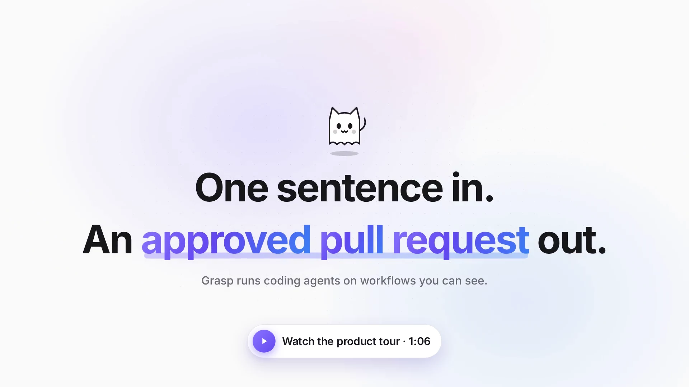
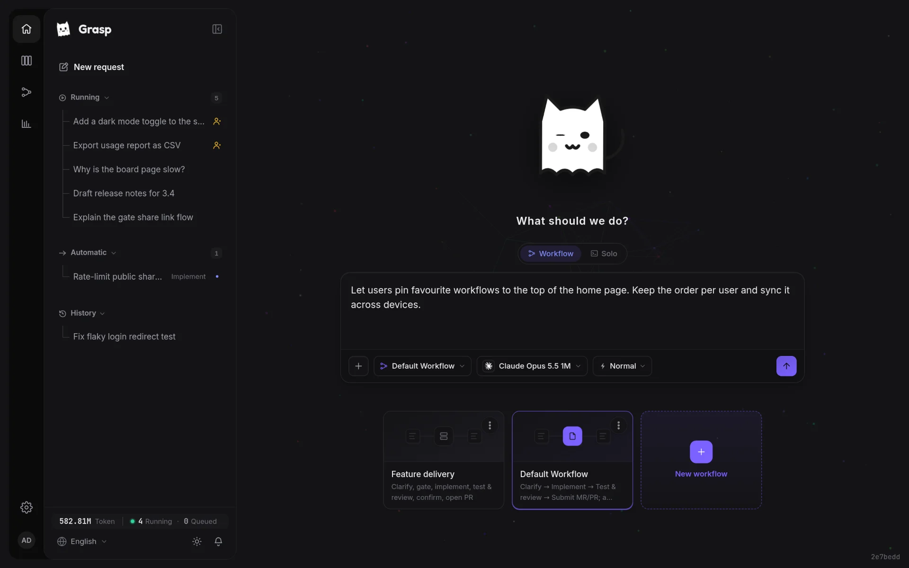
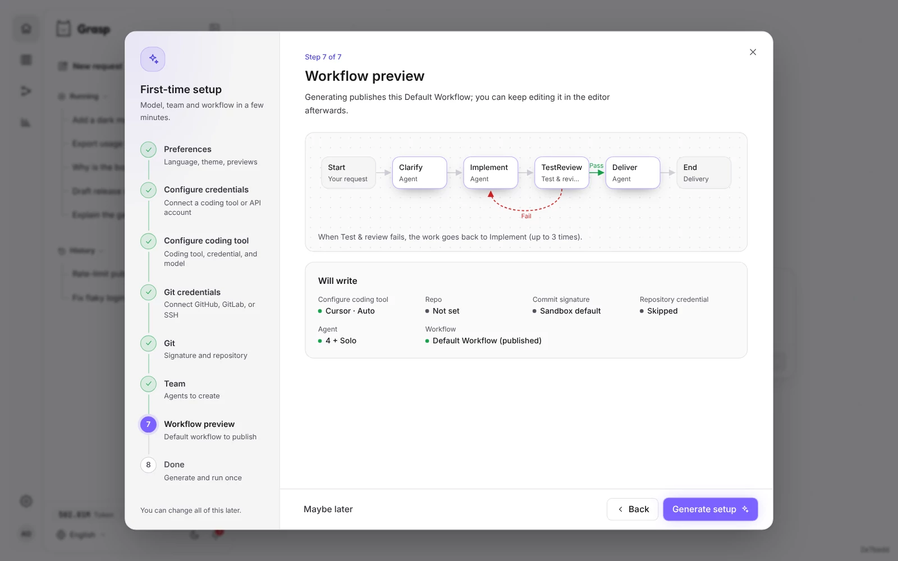
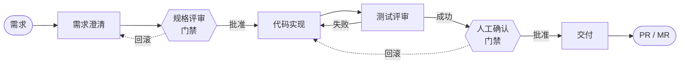
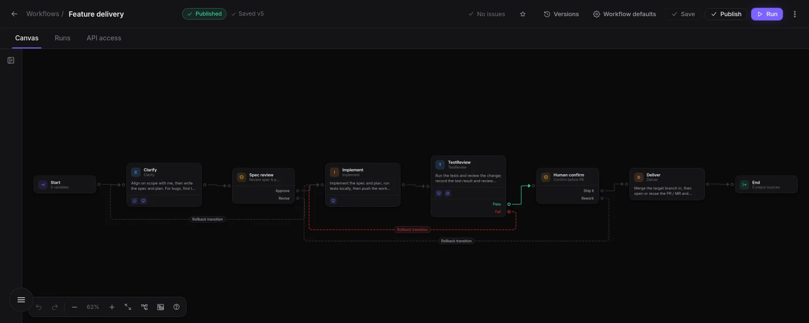
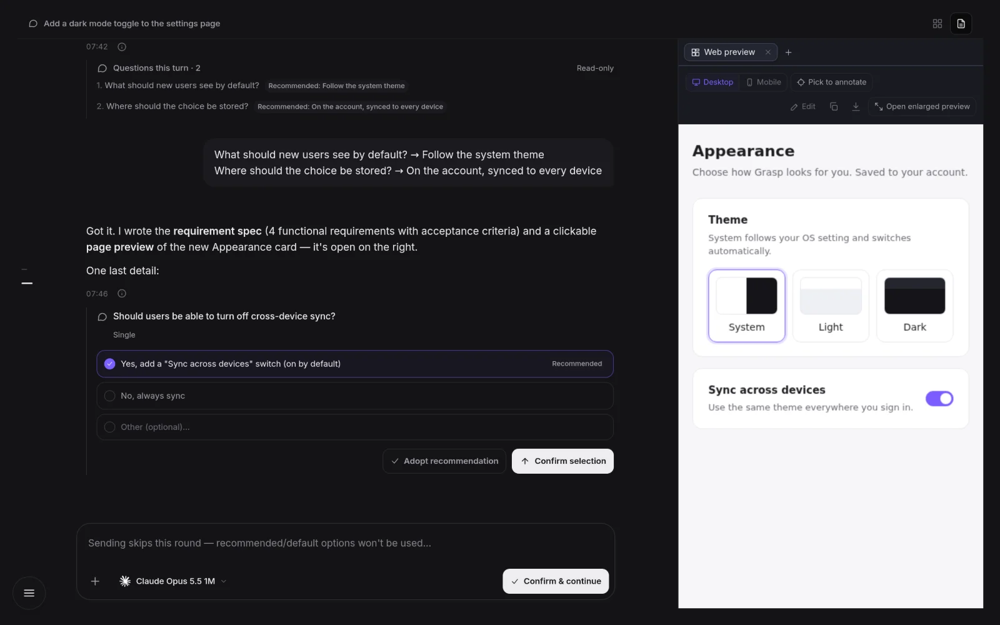
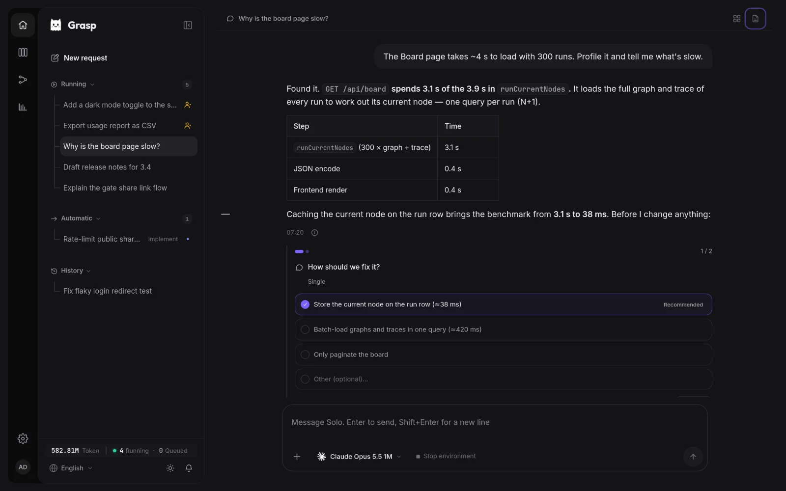
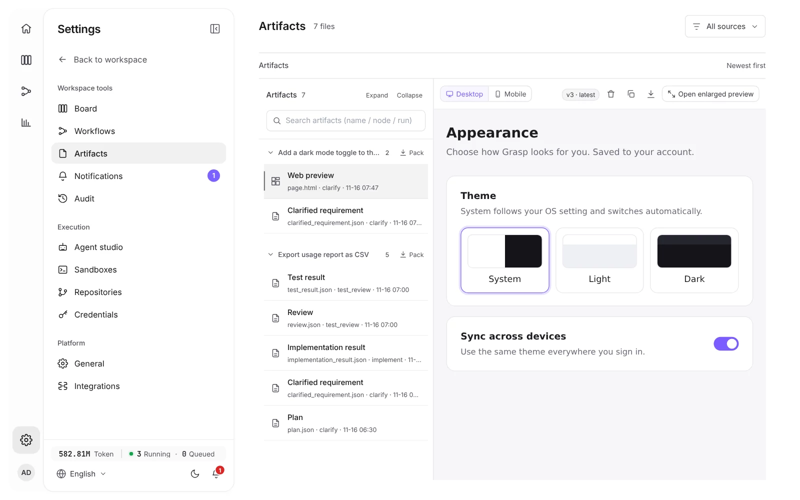
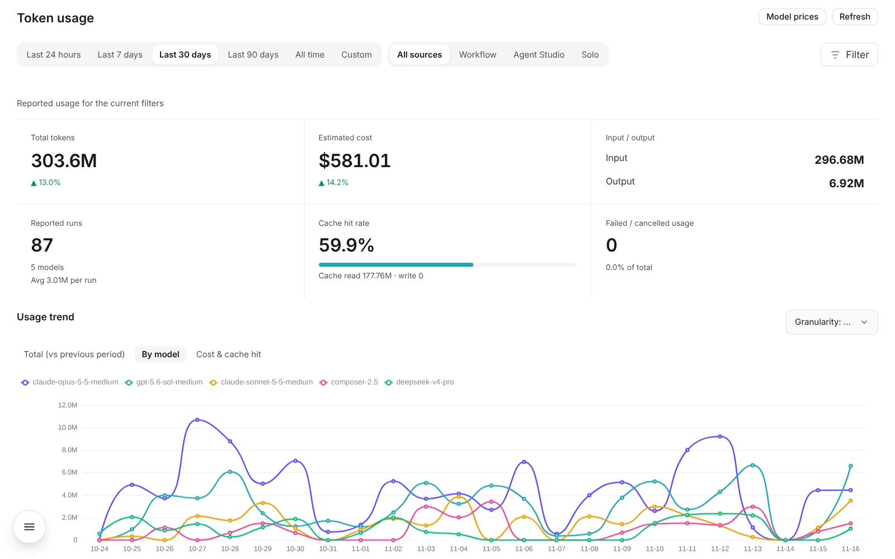
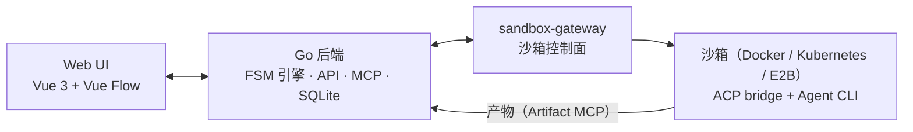

<div align="center">

<picture>
  <source media="(prefers-color-scheme: dark)" srcset="media/logo-dark.svg">
  
</picture>

<h3>一句话需求，到一个审批通过的 PR。</h3>

<p>自托管的 Coding Agent 工作区：Agent 在沙箱里按看得见的工作流干活，<br/>先澄清再动手，交付前必须经过人工审批。</p>

[](https://github.com/cocofhu/grasp/releases)
[](LICENSE)
[](server/go.mod)
[](web/package.json)
[](#部署)
[](https://github.com/cocofhu/grasp/stargazers)

[](https://github.com/cocofhu/grasp/actions/workflows/ci-server.yml)
[](https://github.com/cocofhu/grasp/actions/workflows/ci-web.yml)
[](https://github.com/cocofhu/grasp/actions/workflows/ci-sandbox.yml)
[](https://github.com/cocofhu/grasp/actions/workflows/ci-gateway.yml)

<a href="https://trendshift.io/repositories/95319" target="_blank"></a>

[English](README.md) · **简体中文**

[项目站](https://www.approving-ai.com/) ·
[两种工作方式](#两种工作方式) ·
[快速开始](#快速开始) ·
[工作流](#工作流如何运转) ·
[功能一览](#功能一览) ·
[常见问题](#常见问题) ·
[文档](#文档)

</div>

<p align="center">
  <a href="media/grasp-readme-video.mp4"></a>
</p>

<p align="center"><sub>产品演示（1:28，1080p 60fps，无声）：一句话需求、带可交互页面原型的澄清、FSM 画布、人工门禁、Solo、产物和 Token 成本。</sub></p>

**Grasp** 是一个自托管的工作区，用 Coding Agent 交付软件。一句话描述任务，选择用**工作流**来跑（FSM 画布上编排好的多步流程：需求澄清、实现、测试和人工门禁），或者用 **Solo 会话**来跑（在独立沙箱里与单个 Agent 对话）。两种方式下，Agent 都用可点选的卡片提问，交回结构化产物和可交互的页面预览，而不是一大段文字。

真正干活的是各家 Coding Agent CLI：**Cursor、Claude Code、Codex、CodeBuddy、Trae、OpenCode、DeepSeek Harness、Kimi Code**。Grasp 在它们外面补上画布、沙箱（Docker、Kubernetes 或 E2B）、审批和运行记录，全部跑在你自己的基础设施上，MIT 协议开源。

<p align="center">
  
</p>

<p align="center"><sub>首页。输入需求，选择工作流或切到 Solo，再选模型。所有会话都留在侧边栏，哪个在跑、停在哪一步一目了然。</sub></p>

## 两种工作方式

| | **跑工作流** | **开 Solo 会话** |
| --- | --- | --- |
| 适合 | 阶段固定、要测试和签字确认的重复交付 | 探索、排查问题、一次性改动 |
| 怎么运行 | FSM 引擎沿着显式的 `success` / `failure` / `rollback` 边，依次执行 Agent、分支和人工门禁节点；同一次运行的节点共用一个沙箱 | 单个 Agent 在独立沙箱里工作，带 IDE、终端和浏览器；空闲沙箱自动保存，下次发消息时恢复 |
| 你如何掌控 | 回答澄清卡片；在门禁处审批或打回；给没有账号的人发一次性审阅链接 | 回答 Agent 的提问卡片，随时插话引导 |
| 交付什么 | 规格、计划、页面原型、测试结果、评审意见和 PR / MR | 代码改动，以及侧边面板里的产物和预览 |

两种方式共用同一套 Agent、凭据、产物面板和 Token 统计。

## 为什么做 Grasp

近两年我用 Coding Agent 做了 150 多个个人项目，一直卡在两个问题上：**多项目切换**（哪个 IDE 在跑什么、停在哪一步？）和**读不懂 Agent 输出**（关键改动和待确认的问题淹没在大段对话里）。Grasp 就是我想要的那个工作区：

- **先澄清，再写代码。** 澄清 Agent 一次只问一题并给出推荐答案，然后写出规格、计划和可点击、可批注的 `page.html` 页面原型。
- **显式、可版本化的流程。** 每一步、每一条流转都画在画布上。测试失败退回实现，是因为有一条边这么定义，而不是靠模型自觉。
- **人始终在环。** 流程停在门禁处，等人看完产物后批准或打回。
- **结构化产出，而非长篇大论。** 规格、计划、测试结果、评审和 HTML 预览都是有版本的产物；节点不交齐声明的必填产物就无法完成。
- **你的技术栈，你的服务器。** 8 种 Agent CLI，按仓库独立配置 Git 凭据，沙箱可选 Docker、Kubernetes 或 E2B；凭据保存在工作区，按次注入。

## 快速开始

环境要求：**Linux** 主机，已安装 Git、Docker 和 Docker Compose（服务使用 host 网络模式）。

```bash
git clone https://github.com/cocofhu/grasp.git
cd grasp
./start.sh -d
```

`./start.sh` 拉取 GHCR 已发布镜像，无需本地构建。启动后：

| | |
| --- | --- |
| Web UI / API | <http://localhost:8080> |
| API 健康检查 | <http://localhost:8080/api/health> |
| Gateway 健康检查 | <http://localhost:8899/healthz> |
| 默认账号 | `admin` / `demo1234`（仅限本地试用） |

沙箱镜像会在首次创建沙箱时拉取，也可执行 `./start.sh pull` 提前拉取。

> [!IMPORTANT]
> 当前版本需要全新安装：使用空数据库和空的数据目录。

### 你需要准备什么

| 我想… | 需要 |
| --- | --- |
| 先看看工作区和画布 | 完成快速开始即可 |
| 跑工作流或 Solo 会话 | 一个编码工具的凭据：API Key、模型服务 Key，或 Codex 的 ChatGPT `~/.codex/auth.json` |
| 让 Agent 推送分支、创建 PR / MR | 再加一个 Git 仓库，以及 `gh`、`glab` 或 SSH 凭据 |

### 跑通第一次

1. **登录。** 首次进入会打开安装向导，依次配置偏好、凭据、编码工具与模型、Git（可跳过）和 Agent 团队，最后预览并发布默认工作流：`需求澄清 → 实现 → 测试评审 → 交付`。

   

2. **发起运行：** 在首页输入一句需求，或切到 **Solo**。
3. **回答澄清卡片**，确认规格和页面原型。
4. **在门禁处审查：** 看测试结果、评审意见和代码改动，批准或打回。

<details>
<summary><b>更多配置说明</b>：凭据、常用命令、预置角色</summary>

<br>

- **凭据与模型。** 在「设置 → 凭据」中保存工具平台凭据，或带预设 / 自定义 API 地址的模型服务 Key；在「模型」页把编码工具、凭据和模型保存为一个命名组合，然后在 Agent Studio 里选用。第三方协议会按各工具的支持情况过滤；Codex 支持 ChatGPT 登录文件或 Responses 连接。
- **常用命令。**

  ```bash
  ./start.sh logs        # 查看日志
  ./start.sh gw-logs     # 仅查看 Gateway 日志
  ./start.sh restart     # 重启服务（后台）
  ./start.sh down        # 停止并移除容器
  ./start.sh pull        # 更新服务镜像并预拉沙箱镜像
  ./start.sh dev -d      # 启动源码开发栈（Go + Vite HMR）
  ```

  如需指定镜像版本或 digest，可在 `.env` 中覆盖，参考 [`.env.example`](.env.example)。
- **预置角色包。** `agents/` 提供 `ClarifyAgent`、`ImplementAgent`、`TestReviewAgent`、`DeliverAgent` 四个角色。执行 `./agents/pack.sh`（或 `./agents/pack.sh ClarifyAgent`）在 `agents/dist/` 生成 ZIP，再到 Agent Studio 导入。ZIP 导入后 `acpBackend` 默认为 `cursor`，可在界面中修改。

</details>

## 工作流如何运转

工作流就是一台有限状态机。Agent 和人在同一次运行里协作，每一次流转都是一条看得见的边：



<p align="center">
  
</p>

<p align="center"><sub>同一个工作流在画布上的样子。每个 Agent 节点选择一个角色；失败边和回滚边把工作退回之前的步骤。</sub></p>

| 节点 | 作用 |
| --- | --- |
| **输入 / 输出** | 需求进入、结果离开工作流的位置。 |
| **Agent** | 在沙箱里运行一个角色（后端、模型、`AGENTS.md` 规则和技能），负责澄清、实现、测试、评审或交付。 |
| **人工门禁** | 暂停运行，等人检查产物后批准，或把工作打回。 |
| **分支** | 按运行变量上的条件选择去向。 |
| **赋值** | 写入变量，供后续的 `when` 条件和提示词读取。 |

边分为 `success`、`failure`、`rollback` 三种，都可以加 `when` 条件守卫。回滚时会恢复检查点节点保存的运行变量、带上错误上下文，并计入重试次数上限。同一次运行的所有节点共用一个沙箱，工作目录和未提交的改动都会延续下去。工作流支持版本管理，在画布上直接发布。

## 功能一览

| 方面 | 能力 |
| --- | --- |
| **可视化澄清** | 一次一题的选项卡片，附推荐答案；结构化规格和计划；可切换桌面 / 手机的 `page.html` 原型，可圈选元素写批注发回给 Agent。 |
| **FSM 画布** | 输入、输出、赋值、分支、Agent、人工门禁六种节点；成功 / 失败 / 回滚三种边、`when` 守卫、检查点、版本历史与发布。 |
| **Solo 会话** | 带独立沙箱、IDE、终端和浏览器的一次性 Agent 会话，提问卡片和产物面板与工作流一致。 |
| **结构化产物** | 规格、计划、测试结果、评审和 HTML 预览通过 Artifact MCP 提交，按运行分版本保存；未交齐必填产物的节点无法完成。 |
| **人工门禁** | 在运行页面批准或打回；没有账号的审阅者可以用一次性链接参与。 |
| **Git 交付** | Agent 通过 `gh`、`glab` 或 SSH 推送分支、创建 PR / MR，每个仓库可配置独立凭据。 |
| **Agent Studio** | 可复用的角色（后端、模型、规则、技能），组成团队并在多个工作流间共享。 |
| **观测与成本** | 状态时间线、节点交接说明、沙箱日志，以及按工作流、来源和模型统计的 Token 用量与成本。 |
| **沙箱** | 通过同一个 Gateway 管理 Docker、Kubernetes 或 E2B 沙箱；空闲沙箱自动保存并释放。 |

<p align="center">
  
</p>

<p align="center"><sub>需求澄清：Agent 给出推荐答案提问，旁边的页面原型同步更新。</sub></p>

<p align="center">
  
</p>

<p align="center"><sub>Solo 会话：Agent 分析页面为什么慢，展示工具调用过程，再询问怎么修。</sub></p>

<table>
  <tr>
    <td width="50%"></td>
    <td width="50%"></td>
  </tr>
  <tr align="center">
    <td><sub>产物库与实时 HTML 预览</sub></td>
    <td><sub>按模型统计的 Token 用量与成本</sub></td>
  </tr>
</table>

## 系统架构



| 目录 | 内容 |
| --- | --- |
| `web/` | Vue 3 + Vue Flow 前端：首页、画布、需求澄清、运行详情、Solo、产物库、Agent Studio |
| `server/` | Go 后端：FSM 引擎、HTTP API、SQLite、Artifact MCP 与审计 |
| `sandbox-gateway/` | 沙箱生命周期控制面（`gateway/`）与通用沙箱镜像及运行时（`sandbox/`） |
| `agents/` | 可打包导入的预置角色工作区 |
| `docs/` | 项目主页与中英文帮助文档 |

服务端配置优先级：环境变量 > 挂载配置文件 > 代码默认值。运行时凭据（各后端 API Key、Git Token、SSH 私钥）只保存在「设置 → 凭据」中，按次注入沙箱，不通过服务端进程环境变量下发。

## 部署

| 方式 | 指南 |
| --- | --- |
| **Docker** | [Docker 部署指南](sandbox-gateway/deploy/docker/README.md)：生产 Compose 覆盖、鉴权、沙箱回连与备份 |
| **Kubernetes** | [Kubernetes 部署指南及示例](sandbox-gateway/deploy/k8s/README.md)：命名空间、RBAC、Secret、PVC、Service 和 Ingress。通过 gateway transport 访问 ClusterIP 沙箱，不必为每个沙箱配置 LoadBalancer |
| **E2B** | [E2B 部署指南](sandbox-gateway/deploy/e2b/README.md)，使用独立的 `compose.e2b.yaml`，连接 E2B Cloud 或兼容的自托管控制面。需要预制环境模板和持久化网关状态；预览走 Grasp 路径代理，无需独立泛域名 |

<details>
<summary><b>生产环境检查清单</b></summary>

<br>

- API Key 与 Git 凭据只在工作区凭据设置中配置，切勿提交到代码仓库。
- 通过 digest 固定镜像版本，参见 [Release images and smoke](CONTRIBUTING.md#release-images-and-smoke)。
- 使用反向代理时保留原始 `Host` 请求头，非默认端口也要保留（nginx：`proxy_set_header Host $http_host`）。临时审批链接和登录请求的来源校验都依赖它，详见 [SECURITY.md](SECURITY.md)。
- 工作区页面默认禁止被 iframe 嵌入。需要嵌入门户时，把门户来源写进 `GRASP_FRAME_ANCESTORS`，详见 [server/CONFIGURATION.md](server/CONFIGURATION.md)。
- 成套备份 SQLite（`./.localdata/db`）、附件（`./.localdata/app-data`）、gateway 状态（`./.localdata/gateway`）和原 `GRASP_SECRETS_KEY` / 部署配置。`start.sh` 部署的密钥在 `.env` 中。沙箱工作目录不在这些目录内，需单独备份。

</details>

## 常见问题

**需要 API Key 吗？**
需要，凡是 Agent 干的活都需要：为你选的编码工具准备一个凭据即可（Codex 可以用 ChatGPT 登录文件代替）。Grasp 不提供模型额度，凭据自备。

**一定要有 Git 仓库吗？**
不用。向导里跳过 Git 这一步，Agent 就在沙箱里工作。想让 Agent 推送分支、创建 PR / MR 时，再添加仓库和凭据。

**用工作流还是 Solo？**
探索、排查或小改动用 Solo。希望每个任务都走同样的阶段、有澄清、测试和签字确认时，把它做成工作流。

**和直接用 Cursor、Claude Code、Codex 有什么区别？**
Grasp 不替代它们，而是调度它们。每个 Agent 节点、每轮 Solo 对话背后都是这些 CLI 中的一个，在沙箱里运行。Grasp 补上的是周边的事：哪个角色做什么、按什么顺序、过哪些检查、谁来签字，以及每份产物的完整记录。

**和 Dify、n8n、Flowise 有什么区别？**
它们是通用的 AI / 自动化流程搭建工具。Grasp 专为**用 Coding Agent 交付软件**而做：带真实仓库的沙箱、带页面原型的需求澄清、测试评审回路、人工门禁和 Git 交付。

**可以直接暴露到公网吗？**
默认配置下不行。先替换演示账号、加上 HTTPS，并阅读 [SECURITY.md](SECURITY.md)。安全漏洞请按安全策略私下报告。

## 文档

| 我想… | 从这里开始 |
| --- | --- |
| 了解核心概念、跑起来 | [核心概念](docs/content/guide/concepts.md) · [快速开始](docs/content/guide/quick-start.md) |
| 配置 Grasp 和沙箱 | [配置与默认值](CONFIGURATION.md) · [完整环境变量表](server/CONFIGURATION.md) |
| 了解沙箱生命周期和 Gateway | [沙箱生命周期](docs/content/help/sandbox-lifecycle.md) · [Gateway 契约](GATEWAY.md) |
| 开发后端 | [后端说明](server/README.md) |
| 获取帮助、关注版本 | [支持渠道](SUPPORT.md) · [更新日志](CHANGELOG.md) · [安全策略](SECURITY.md) |

## 参与贡献

欢迎提交 Issue 和 Pull Request：分享使用场景、报告问题，或改进工作流、Agent 和界面。提交前请阅读 [CONTRIBUTING.md](CONTRIBUTING.md)、[AGENTS.md](AGENTS.md) 和 [行为准则](CODE_OF_CONDUCT.md)，各模块的 lint、单元测试与 E2E 命令详见其中。

## 许可证

[MIT](LICENSE) © 2026 cocofhu
