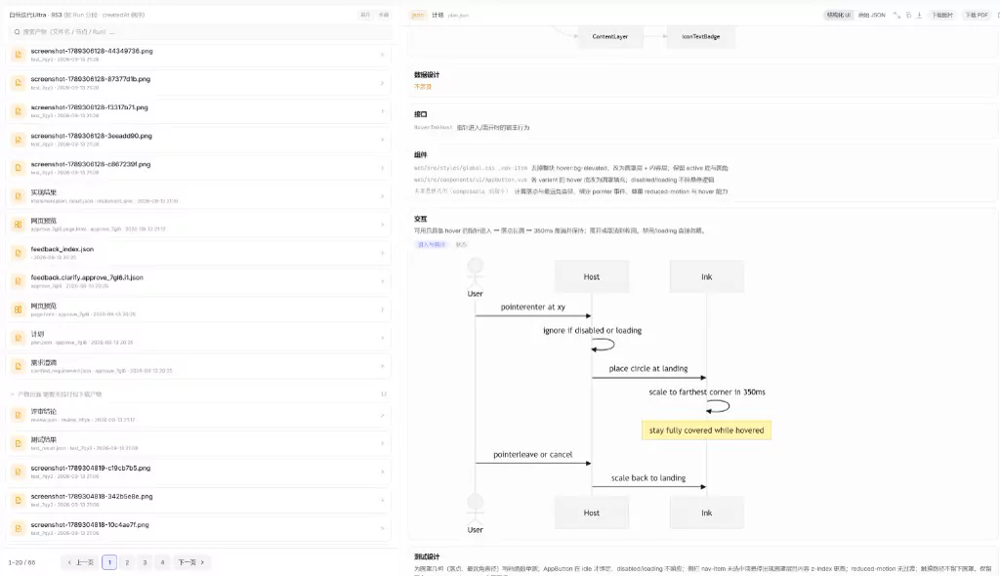
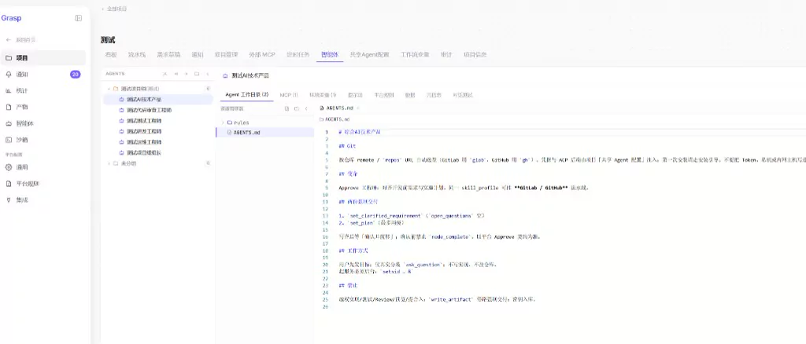
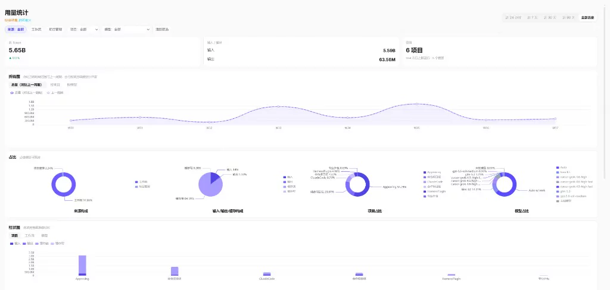
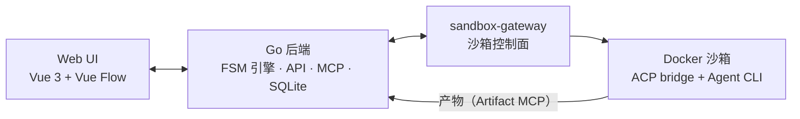

<div align="center">


<h3>把 Coding Agent 编进可审批的工作流，一眼看懂它干了什么</h3>

[](https://github.com/cocofhu/grasp/releases)
[](LICENSE)
[](server/go.mod)
[](web/package.json)
[](https://github.com/cocofhu/grasp/actions/workflows/ci-server.yml)
[](https://github.com/cocofhu/grasp/actions/workflows/ci-web.yml)
[](https://github.com/cocofhu/grasp/actions/workflows/ci-sandbox.yml)
[](https://github.com/cocofhu/grasp/actions/workflows/ci-gateway.yml)

[English](README.md) | **简体中文**

[项目站](https://www.approving-ai.com/) · [快速开始](#快速开始) · [功能](#功能一览) · [工作原理](#工作原理) · [文档](#文档) · [参与贡献](#参与贡献)

<a href="media/grasp-readme-video.mp4"></a>

<sub>▶ 23 秒 · 1080p · 无声 · 真实运行录屏：登录 → 首次安装向导 → 工作流画布 → 首页 → Agent Studio</sub>

</div>

## Grasp 是什么

这两年我做了 150 多个个人项目，最头疼的就两件事：

- **项目一多就乱**：IDE 来回切，哪个在跑、跑到哪了，全靠脑子记；
- **Agent 的输出看不过来**：一大段一大段往外倒，关键信息埋在里面，光读懂就要花半天。

所以我做了 Grasp。它把所有项目收到一个平台里，用一张有限状态机（FSM）画布把 Agent 串成工作流：需求先可视化澄清，Agent 的产出整理成结构化产物，关键步骤停下来等人拍板。Agent 可以跑得很快，但该人决定的事还是人说了算。

后端支持 **Cursor、Claude Code、CodeBuddy、Trae、OpenCode、Codex**，每个 Agent 都跑在独立的 Docker 沙箱里。

## 完整演示

https://github.com/user-attachments/assets/47728d1f-54a1-485e-967e-28d8c716ed36

## 功能一览

### 编排

| 功能 | 说明 |
|---|---|
| FSM 画布 | 六种节点：Agent、输入、输出、赋值、分支、人工门禁；边分成功 / 失败 / 回滚，支持 `when` 守卫和检查点 |
| 内置模板 | 需求澄清 → 实现 → 测试评审，评审不过自动回到实现 |
| 一句话启动 | 在首页输入一句需求就能起一个 run |
| 并行 run | 多个 run 同时跑，审批都收在一个收件箱里 |

### 人审

| 功能 | 说明 |
|---|---|
| 可视化澄清 | 澄清 Agent 和你多轮对话，产出需求规格、计划，以及可选的 `page.html` 预览 |
| 人工门禁 | run 停在 gate 上等你批准或驳回，收件箱和运行详情里都能操作 |
| 临时审批链接 | 给没登录的人生成一次性链接，打开就是同样的审批界面 |
| 结构化产物 | 产物按 run 隔离（Artifact MCP），必填产物缺了节点直接失败 |

### 执行与交付

| 功能 | 说明 |
|---|---|
| Docker 沙箱 | 每个 Agent 跑在隔离沙箱里，runtime 第一次用时按需拉取 |
| Git 交付 | 沙箱里可以用 `gh` / `glab` / SSH 提 PR / MR |
| 可观测 | 时间线、沙箱日志、产物、Token 用量和成本统计 |
| Agent Studio | 管理 Agent、后端和凭据，可导入 `agents/` 里打包好的角色 |

<table>
  <tr>
    <td></td>
    <td></td>
    <td></td>
  </tr>
  <tr align="center">
    <td><sub>产物审查</sub></td>
    <td><sub>Agent Studio</sub></td>
    <td><sub>Token 用量</sub></td>
  </tr>
</table>

## 快速开始

需要一台 **Linux** 机器，装好 Git、Docker 和 Docker Compose（服务用的是 host 网络）。

```bash
git clone https://github.com/cocofhu/grasp.git
cd grasp
./start.sh -d
```

默认直接拉 GHCR 上发布好的镜像，不用本地编译。起来以后：

| 地址 | 用途 |
|---|---|
| <http://localhost:8080> | UI / API |
| <http://localhost:8080/api/health> | API 健康检查 |
| <http://localhost:8899/healthz> | Gateway 健康检查 |

本地演示账号是 `admin` / `demo1234`，只适合自己玩，共享或生产环境请换成自己的账号。

> 沙箱 runtime 会在第一次建沙箱时拉取，想提前拉好就跑 `./start.sh pull`。

### 跑第一个工作流

1. 用演示账号登录。新装的实例是空的，不会自动建样例。
2. 进 **Agent Studio** 建一个 Agent，后端选 `cursor`、`claude_code`、`codebuddy`、`trae`、`opencode` 或 `codex`，填上 API Key。Codex 用的是 ChatGPT 登录文件（`~/.codex/auth.json`），不用 API Key。
3. 打开画布，从默认模板开始，或者从左侧把 Agent 和门禁拖进来，连好成功、失败、回滚边。
4. 发布，启动 run（或者在首页用一句话启动），然后盯着收件箱等门禁。

### 常用命令

```bash
./start.sh logs        # 看日志
./start.sh gw-logs     # 只看 Gateway 日志
./start.sh restart     # 重启（后台）
./start.sh down        # 停掉
./start.sh pull        # 刷新镜像和沙箱 runtime
./start.sh dev -d      # 源码开发栈：Go + Vite HMR
```

镜像 tag / digest 可以在 `.env` 里改，参考 [`.env.example`](.env.example)。

### 导入自带的角色 Agent

`agents/` 里有五个现成的角色：PMAgent、ClarifyAgent、ImplementAgent、TestReviewAgent、DeliverAgent。

```bash
./agents/pack.sh               # 全部打包到 agents/dist/
./agents/pack.sh ClarifyAgent  # 只打一个
```

然后在 Agent Studio 里导入 ZIP。目前导入不会保留 `acpBackend`，导进来默认是 `cursor`，需要的话导完再改。

## 工作原理



一个典型的交付流程长这样，失败边和回滚边都画在同一张画布上：

```text
需求澄清 → 技术调研 → 人工门禁
        → 执行计划 → 代码实现 → 测试验证 → 代码评审
        → 人工确认 → PR / MR
```

| 目录 | 内容 |
|---|---|
| `web/` | 画布、首页澄清、运行详情、收件箱、Agent Studio |
| `server/` | FSM 引擎、API、SQLite、Artifact MCP、调度和审计 |
| `sandbox-gateway/` | 沙箱生命周期控制面（`gateway/`）和通用沙箱镜像（`sandbox/`） |
| `agents/` | 可导入的角色 Agent |
| `docs/` | 项目站和中英文帮助文档 |

配置优先级：环境变量 > 挂载的配置文件 > 代码默认值。

## 部署前看一眼

- API Key 和 Git 凭据只在项目凭据界面里配，别提交进仓库。
- 生产环境建议用 digest 固定镜像，见 [Release images and smoke](CONTRIBUTING.md#release-images-and-smoke)。
- 走反向代理时要保留原始 `Host`（比如 nginx `proxy_set_header Host $host`），临时审批链接是按它生成的，详见 [SECURITY.md](SECURITY.md)。
- SQLite（`./.localdata/db`）和附件（`./.localdata/app-data`）是分开挂的，备份和清理要一起做，不然会出现引用了 `blob:` 却 404 的情况。

## 文档

- [核心概念](docs/content/guide/concepts.md) · [快速开始](docs/content/guide/quick-start.md)
- [完整配置](server/CONFIGURATION.md) · [后端说明](server/README.md) · [Gateway 契约](GATEWAY.md)
- [安全策略](SECURITY.md) · [支持渠道](SUPPORT.md) · [更新日志](CHANGELOG.md)

## 参与贡献

欢迎提 Issue 和 PR。动手前先看看 [CONTRIBUTING.md](CONTRIBUTING.md)、[AGENTS.md](AGENTS.md) 和 [行为准则](CODE_OF_CONDUCT.md)，各模块的 lint、测试、E2E 命令都写在里面。

<a href="https://trendshift.io/repositories/95319" target="_blank"></a>

## 许可证

[MIT](LICENSE) © 2026 cocofhu
