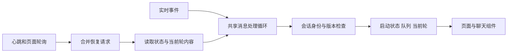

# 工作流聊天状态与恢复

这份设计约束澄清收件箱、运行详情和实时运行页的聊天数据流。聊天组件继续负责
消息渲染、草稿、附件和乐观发送；页面不再分别推断服务端队列的含义。

## 状态的来源

| 数据 | 权威来源 | 前端用途 |
| --- | --- | --- |
| 排队项、当前请求、执行中状态 | 平台 FIFO 的 `review` 事件和 `reactSessions` 快照 | 更新队列与当前轮；决定是否等待下一条消息 |
| 消息身份 | `clientMessageId` 和服务端 item ID | 关联乐观发送、开始、结束与持久化历史；同文消息不能互相代替 |
| 思考、正文、工具与用量 | ACP 实时事件和节点 events 快照 | 更新当前轮内容；内容暂时静默不能证明该轮已经结束 |
| 沙箱是否仍运行 | `sandboxBusy`、`sandboxDesynced`、运行中的 op ID | 保留平台已失去跟踪的实际输出，提供恢复依据 |
| 网络是否可用 | WebSocket 心跳、关闭与重连 | 维护连接；心跳正常不能证明聊天状态已经完整同步 |

ACP 的 `liveness` 只证明进程存活。原生回调可能同时重发旧正文、旧工具和新的
存活采样，因此内容进度比较剔除 `liveness` 与事件偏移 `t` 后的完整语义快照。
重复累计内容不能作废正在进行的补读；工具输出、输入、摘要、状态、用量等真实
变化仍必须更新。新活动请求或访问会重置比较基线，同文的不同请求继续分别处理。
渲染器同样将纯存活采样作为观察帧：保留已显示的正文与工具，也不因此创建空回复。
带有累计内容的混合帧继续正常更新。

共享的 `web/src/lib/chat/reviewSessionState.ts` 负责队列快照投影、服务端事件更新和
恢复读取的时序规则。`sessionQueue.ts` 保留低层版本游标与按身份匹配的队列操作。
页面适配器只负责选中哪段对话、获取数据、把接受的状态交给对应组件。

## 必须保持的约束

1. 服务端 `sessionGeneration`、`revision` 决定状态顺序，网络到达顺序和消息正文
   都不能替代它们。新一轮开始后，旧读取不能释放它的 busy 或覆盖它的内容。
2. 完整快照没有某个 FIFO，只有 `reviewSessionGeneration` 覆盖已知会话代次时，
   才能认定该 FIFO 已移除。旧服务器的无版本快照不能推翻已接受的有版本会话。
3. 恢复读取不能受本地 busy 阻挡。busy 可能正是遗失结束通知留下的旧状态。
   返回的真实 busy 则必须继续保留活动请求和后续队列，不能按超时伪造成功。
4. 队列状态和输出内容独立更新。空队列不等于 Agent 完成；ACP 的 busy 也不能
   代替平台 FIFO 的 busy。观察到的正文不能确认尚未开始的另一条发送。
5. 正常刷新和断线恢复使用相同的状态投影。组件没有挂载时可以缓冲，挂载后按
   同一套身份与版本规则接管，不能另造一份队列。
6. 当前访问已经就绪后，迟到的列表不能把它退回启动中。就绪事实同时核对节点
   轮次和服务端启动时间；新一轮或不同的启动时间仍按新启动处理。

## 恢复过程

页面沿用现有轮询和 WebSocket 心跳检查权威状态，不增加独立的无限重试循环。
恢复请求记录当前访问、会话和输出进度；页面切换、较新的服务端状态或输出到达后，
旧请求失效。

处理循环按到达顺序处理同步消息。恢复读取作为异步任务运行，实时事件继续被处理；
同一时刻只运行一次恢复，读取期间的新恢复请求合并成一次后续处理。访问重置或卸载
取消旧任务，旧任务返回也不能恢复上一段会话。

每次恢复读取有 60 秒期限。到期时取消读取并使它的检查点失效，即使底层请求没有
响应取消，处理循环也能继续执行最新的后续恢复。迟到的结果不能再写入页面；取消
读取不会清空队列，也不会把真实执行中的 Agent 标记为完成。

首次加载尚无聊天面时，上下文读取使用同样的期限；完成、取消或超时后释放当前
访问的读取锁，不能让一次未返回的初始请求挡住后续恢复。启动、重试与沙箱孤立
输出的补读也通过共享恢复通道，并检查会话、节点轮次、连接和输出进度。

- **结束通知遗漏：** 接受最新队列快照，释放已结束的活动轮，读取持久化历史。
  服务端仍有排队项时保留它们，等待真实的下一轮开始。
- **输出通知遗漏：** 会话仍执行且缺少新的实时内容时，读取当前节点 events。
  只把仍属于同一轮、且没有被新实时内容超越的结果投递到当前组件。
  工具和时间线可以先于思考、正文出现，也属于可恢复的内容。自动观察页的正常
  轮询同样补读已展示节点；读取过程中有新内容到达时丢弃旧补读。
- **平台空闲、沙箱仍运行：** 保留当前实际输出并继续只读核对；沙箱空闲后的
  快照收拢这段输出。本地的“思考中”不能阻止这次核对。
- **网络断开：** 使用已有心跳超时和重连退避；新连接先安装完整会话快照，再恢复
  对应轮的内容，最后接收增量。
- **启动通知遗漏：** 当前对话的权威上下文已经离开启动状态时，更新选中项和启动
  记录，挂接当前轮及其内容。全局列表刷新和本地输入锁不能阻止当前会话进入就绪。
  同轮的输出继续到达时，允许推进就绪状态；较早的内容快照仍必须丢弃。

恢复只执行读取，不重新发送已经接受的用户消息，也不为了清空队列自动取消 Agent。

拒绝快照必须同时拒绝它的隐式授权：没有当前会话可替换时，该节点不能进入游标
安装字典，否则旧代次的后续实时帧仍可能复活退休 FIFO。确认动作同样按请求记录
归属清理；迟到失败不能留下原 pending handoff，成功或失败也不能释放同键的新确认。

## 回归边界

共享状态层测试覆盖版本倒退、缺失 FIFO、相同正文的不同身份、连续轮次和队列保留。
各页面适配器分别验证正常心跳下遗漏结束、遗漏输出、旧读取晚于新轮、页面切换，
以及真正运行中的状态不被恢复过程误清理。组件和浏览器用例继续验证用户消息只出现
一次、草稿保留、后续问题可交互和队列按真实执行顺序推进。

传输层还必须保留正文、错误和结束的顺序。服务端 ACP 有界缓冲满时使用可取消的
背压；不能静默丢掉结束通知，再依靠前端猜测本轮是否完成。

## 历史故障验收矩阵

2026-10-30 沿相关路径追溯 Git 差异与测试实现。下列 19 类触发来自历史修复；
它们的原有回归继续保留，本次统一循环另覆盖多种投递顺序和组合故障。
浏览器使用真实页面和组件、模拟 API/WS；服务端组合测试使用真实 WebSocket 和
`chatsession` FIFO，不请求付费模型。通过这些测试证明列出的边界，不能替代部署后
对实际服务和网络环境的核对。

| 历史提交 | 故障触发顺序 | 回归证据（文件中的测试名） |
| --- | --- | --- |
| `d26f472a` | 订阅缓冲满后结束帧无法送达，连接仍开放 | `server/internal/chatsession/stream_test.go`：`TestStreamTerminalFrameDelivery`、`TestStreamSlowSubscriberDeliversAfterDrain`、`TestStreamSlowSubscriberClosesOnUndeliverableFrame` |
| `2882fbea` | WS 写操作阻塞时订阅关闭，发送泵无法退出 | `server/internal/handlers/chat_subscription_test.go`：`TestPumpSubscriptionCloseWhileWriteBlocked` |
| `d26f472a`、`2882fbea` | 新旧轮同文，旧历史提前结算或吞掉新轮 | `web/src/components/run/ClarifyChat.test.ts`：`keeps a new same-text turn when only the previous turn is persisted`、`keeps a second identical human and reply when idle arrives before the snapshot` |
| `8a96dc01` | HTTP 已接受但还没有开始帧，短历史快照删除刚发送的用户行 | 同文件：`accepted send stays in the transcript before any frame, including a shorter snapshot` |
| `f4ac5af9` | A 的历史追上时，B 仍排队；合并误删 B 或为 B 画空失败 | `web/src/lib/inbox/mergeClarifyLiveTurns.test.ts`：`keeps a later accepted row after the snapshot settles the in-flight turn`；`ClarifyChat.test.ts` 的 pending user row 回归 |
| `4ca6c74b` | WS 已开始、结束甚至持久化，HTTP 接受响应才返回；或 HTTP 报错但 WS 已确认 | `web/src/lib/inbox/useClarifyChat.actions.test.ts`：`accepted message reconciliation` 的 streaming/finished/persisted 参数化用例及 matching WebSocket output 回归 |
| `4ca6c74b`、`ca9b5fe6` | 多窗口相同正文、图片或标注，按正文确认错了消息身份 | `web/src/lib/chat/sessionQueue.test.ts`：`never adopts another tab same-text queue item as its own optimistic send`；`useClarifyChat.actions.test.ts` 的 same-text waiter cancel/edit 回归 |
| `ca9b5fe6` | 旧排队快照在 A/B/C 全完成后才抵达，重新放回旧项 | `server/internal/chatsession/session_test.go`：`TestSessionDelayedQueueFrameCannotBecomeNewerThanCompletedTurns`；`useClarifyChat.actions.test.ts` 的 older enqueue snapshot 回归 |
| `ca9b5fe6` | 并发发布时先分配序号的帧后到达 | `stream_test.go`：`TestStreamConcurrentPublishWaitsForEarlierDelivery`、`TestStreamConcurrentPublishersDeliverIncreasingSequences` |
| `ca9b5fe6` | FIFO 清理时新发送者已取得旧引用，注册表又建立第二个泵 | `server/internal/chatsession/registry_test.go`：`TestRegistryAdmissionLeaseKeepsOnePumpForConcurrentSenders`、`TestRegistryRejectedAdmissionReleasesIdleSession` |
| `ca9b5fe6`、`1971431e` | 取消发布阻塞时下一轮已开始，迟到取消误杀新轮；或清队列持久化晚于原生取消 | `session_test.go`：`TestSessionDelayedCancelPublicationCannotCancelNextTurn`、`TestSessionCancelPersistsDroppedItemsBeforeInterruptingActiveTurn` |
| `ca9b5fe6` | 一个查看者重连的旧队列头广播给其他查看者 | `server/internal/engine/review_session_test.go`：`TestReviewSessionReconnectReplayIsTargetedAndKeepsCapturedVersion` |
| `ca9b5fe6` | 空快照后迟到的退休 FIFO 复活；或反向误拒绝新 FIFO | `session_test.go`：`TestSessionSnapshotWatermarkDistinguishesRetiredAndNewSessions`；`sessionQueue.test.ts` 的 retired/new snapshot 回归 |
| `ca9b5fe6` | 同文并发请求完成后，数据库重载丢失身份，历史又被合并 | `server/internal/engine/chat_identity_test.go`：`TestChatIdentitySeparatesConcurrentSameTextRequestsAfterHistoryReload`、`TestChatIdentityRetryKeepsOriginalHumanGroupWithoutBackfillingLegacy` |
| `814c77e4` | A→B 或 A→B→A，旧 GET/seed/chain/socket/send/confirm 返回到新页面 | `web/src/lib/run/useRunLive{,.actionsIsolation}.test.ts`、`useGatesInbox.actions.test.ts` 的同节点跨会话及旧连接回归；`web/e2e/run-live-continue.spec.ts` 的真实页面切换 |
| `cd454283` | 平台 FIFO 已空闲，但原生沙箱仍在输出 | `useClarifyChat.actions.test.ts`：`keeps painting when the platform goes idle but the sandbox turn is still running`、`paints a late thought after turn_done when the sandbox is still running` |
| `8c4460e4` | steer 中断或仍排队时取消，因无标记误判成功；重试错用后来的参数 | `server/internal/engine/live_test.go`：`TestInterruptedSteerDoesNotInferSuccessFromNoMarkers`、`TestCancelQueuedSteerCanBeDismissed`、`TestFailedSteerRetryOrDismiss` |
| `02995a29` | 提前确认时对话先关闭，驱动尚未暂停或后继记录未创建，当前节点暂时丢失 | `server/internal/services/run_current_pending_test.go`、`server/internal/engine/pending_auto_test.go` 的 early confirm/current node 回归 |
| `4357f8dd` | 续跑返回时仍显示失败/取消，侧栏留在历史区 | `TestResumeFromLeavesTerminalBeforeReturn`；`useRunDetail.actions.test.ts` 的 sidebar resume 回归 |

本次追加的组合验证：

- `reviewSessionState.history.test.ts`：真实服务端帧形状的 WS/REST/混合投递、重复、
  乱序、取消位置、代次水位及恢复与新帧、重置、卸载、期限的交错。
- 三个宿主分别验证空 ACP、纯 `liveness` 和旧累计内容加新 `liveness` 在状态与内容
  读取期间到达，仍能补回遗漏输出并结算完成；真实的新内容仍使旧补读失效。
- Inbox/详情的工具先行补读，以及组件只改变工具 `output/input/summary/durationMs`
  的 DOM 回归；纯存活帧保留工具详情且不创建空槽，混合帧仍更新；自动观察页
  补读时保持新实时输出。
- `gates-typing-autoapply.spec.ts`：纯工具、持续存活采样、WS 先于 HTTP 确认、三条
  同文不同身份的发送、遗漏全部开始/结束、旧队列帧重放合并在一条真实页面用例中。
  断言每条只出现一次、无重复 POST、队列结算、工具输出更新、草稿保留、没有刷新。
- `acp_session_integration_test.go`：六项 FIFO 串联两轮 burst 失败、完整/不完整 EOF、
  重连；另将清队列持久化阻塞、新入队、取消慢发布和迟到旧 op 帧串联。断言完整
  内容、明确终态、请求身份、只执行一次、原生取消顺序与 admission lease 释放。

新增关键回归在恢复旧逻辑后失败、当前实现通过：包含进展计数与纯正文过滤的 13 个
宿主边界、工具字段更新的 4 个 DOM 边界、自动观察页补读，以及旧 ACP 缓冲与
`1971431e` 之前取消顺序的真实 WS/FIFO 组合。执行结果写入 `DEVLOG.md`。

## 真实模型验收

2026-10-30 使用临时授权的真实 DeepSeek Flash、原生 dsh 0.2.1-rc.2、当前源码
构建的服务端和运行时，在隔离 worktree 模式执行 12 条验收消息。浏览器使用真实
API 与页面，同时观察澄清收件箱、运行详情和实时页；故障代理只丢通知，不替换
模型回复或状态接口。覆盖不同正文 FIFO、三条同文、遗漏 ACP 与开始/结束通知，
以及入队后仅保留心跳、丢弃其他运行通知。所有回复按身份分别完成，队列依次
2/1/0 后退休；页面自行恢复、保留草稿，没有刷新、重连或浏览器错误。

真实日志还暴露单轮工具摘要误读完整历史的缺陷。公共回复投影现在只读取当前
`prompt…turn_end` 范围，保留本次回复的隐藏续轮，跳过确认收尾拼接中的旧快照。
旧格式没有 prompt 时保留时间线分段兼容。Tools 与 Parts 共用该范围，完整 Events
仍用于会话历史。模型单测和澄清、复审、审批修改的持久化回归验证工具数 1/1/0，
空当前轮不能回捞旧步骤；最终真实三轮均只记自己的一个工具。

这项人工授权的付费验收不改变免费 CI 的模型边界。凭据和私有数据仅存在于临时
隔离环境，完成后清理；生产部署与生产容器网络仍需另外验证。

## 多工作流与访问隔离

后端 FIFO 按 run 和 node 分区；前端控制器由每个宿主实例持有，换 run 时必须
重置，不能把另一工作流中相同 node 名称的代次、busy 或缓存沿用。页面级 HTTP
发送、确认和产物旁路也必须检查访问代次，不能只判断返回时的 run/node 相同：
A→B→A 已经是新访问。同步更新的访问代次同时约束嵌套异步收尾；组件回调及
finally 仅能清理原请求所属会话。迟到发送失败只能处理原发送者的 outbox/stash，
不能恢复到当前另一个工作流的草稿；同一访问的产物读取也按请求序号拒绝旧结果。

补充的真实验收创建三个不同工作流，所有节点都名为 clarify，九条用户消息正文
完全相同，回复由各工作流专属标记区分。三个 FIFO 同时各有两条等待，代次为
6/5/4；切换从较高代次 A 到较低代次 B 仍正常处理。三个原生会话的首轮执行
区间重叠，确认实际并发。仅 A 丢通知、保留心跳时，B/C 保持正常推送；九个页面
各自结算，A 的实时页无需切换或重连也补回全部回复。

同页反复 A→B→A 时，延迟释放真实 A 的 HTTP 接受响应和 context，B 的草稿与
内容保持自己的状态，返回 A 恢复 A 的独立草稿。确定性回归另覆盖迟到 409、普通
拒绝、force 成功/失败、收尾等待中切换，以及产物跨访问和同访问乱序；首批
11 例在旧实现失败，本次新增 19 例全部通过。实际 Key 不进入仓库或测试日志。
