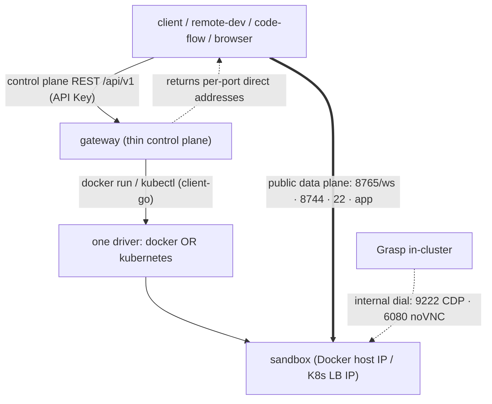

# Sandbox Gateway

A thin control-plane service that manages the lifecycle of sandboxes (instances
of the Phase 1 universal image in [`../sandbox`](../sandbox)) and returns the
client-reachable address for each exposed port.

Legacy v1 clients connect to the returned endpoints directly. Opt-in v2
transport carries TCP through authenticated, sandbox-scoped WebSockets, so
Grasp can run outside the gateway's provider network. CDP/noVNC stay internal:

- session / agent bridge (WSP/1): `8765` — **public**, session auth
- code-server (web IDE): `8744` — **public**, IDE password
- SSH (shell, exec, file transfer): `22` — **public**, `ROOT_PASSWORD` / `SSH_KEY`
- Chromium CDP: `9222` — **internal only** (container / ClusterIP)
- noVNC preview: `6080` — **internal only** (container / ClusterIP)

Users reach noVNC via Grasp `/sandbox-vnc/:id/ws`, one desktop per sandbox
(Session when Auth is on). Grasp
outside the cluster or Docker network uses gateway transport for CDP/noVNC.

There is no gateway `exec`/`files`/`terminal` API: run commands and move files
over SSH, either directly or through the TCP channel. See the
[Grasp connection and migration configuration](../../GATEWAY.md#gateway-transport-and-multiple-deployments).

## Drivers (one per deployment)

A gateway instance runs exactly one driver, selected by `driver` in the config:

- `docker` — local testing. Publishes **Public** ports only (`session`/`ide`/`ssh`/`app`)
  on a host IP (`bindIP:ephemeral`). CDP/noVNC are **not** `-p` mapped; Endpoints
  backfill them from the container IP (`Networks[name].IPAddress` when a custom
  network is set). Already-running `-p` mappings are not rewritten (TTL/Reinstall).
- `kubernetes` — production. ClusterIP Service includes Public+Internal (Listen).
  LoadBalancer Service publishes **Public** only. Endpoints merge LB IP for public
  ports and ClusterIP DNS for `cdp`/`novnc`. `ensure*` updates existing Service
  `Spec.Ports` on AlreadyExists. Driver Options carry Public/Internal so
  `ReconcileOnStartup` / `Start` / `Get` call `ConvergePublishSurface` and heal
  inventory `*-lb` after upgrade (not only Create/Reinstall). Until that
  reconcile finishes, a pre-existing LB may still expose 9222/6080.

- `e2b` — approved prebuilt templates with persistent private relay endpoints;
  see the [E2B guide](../deploy/e2b/README.md).

Docker, Kubernetes and E2B are separate deployments, one driver per instance.

Legacy direct topology (v2 instead routes Grasp's data through the gateway):



## Layout

```
gateway/
├── cmd/server/main.go          # config -> DB -> pick driver -> router -> serve + reconcile
├── config.docker.example.yaml
├── internal/
│   ├── config/                 # YAML + SBGW_* overrides
│   ├── database/               # SQLite (glebarez) + AutoMigrate
│   ├── models/                 # Sandbox model (endpoints/env/labels as JSON columns)
│   ├── store/                  # GORM-backed metadata store
│   ├── driver/                 # Driver interface (lifecycle + Endpoints)
│   │   ├── docker/             # docker CLI driver
│   │   └── kubernetes/         # client-go driver + MetalLB LoadBalancer
│   ├── service/                # SandboxService: orchestrate driver+store, async finalize, reconcile
│   └── api/                    # Gin handlers + router + API-key middleware
└── docs/API.md
```

## Run (local, Docker driver)

For a complete stack, use the [Docker deployment guide](../deploy/docker/README.md).
For Kubernetes, use the [full manifests and guide](../deploy/k8s/README.md);
the older `pods/log` files only add permissions to an existing installation.
The following starts the control plane alone for development:

```bash
cp config.docker.example.yaml config.yaml
# edit config.yaml: set docker.image to your built universal-sandbox image
go run ./cmd/server -config config.yaml
```

Check the control plane:

```bash
curl --fail --silent http://localhost:8080/healthz
```

Create the acceptance-test sandbox through Grasp. The environment image needs
`GRASP_RUNTIME_URL` and the scoped download authorization that Grasp injects;
a create request containing only `AGENT_PROVIDER` exits during bootstrap.
Custom API clients must supply the [runtime bootstrap contract](../../GATEWAY.md#minimum-compatible-api)
and validate callbacks from inside the sandbox before testing its endpoints.

Set `auth.apiKeys` (or `SBGW_API_KEYS=k1,k2`) to require
`Authorization: Bearer <key>` on `/api/v1/*`. Authenticated v2 transport also
requires a configured API key; the health endpoint does not require one.

## Configuration

Choose exactly one backend file: [Docker](config.docker.example.yaml),
[Kubernetes](config.kubernetes.example.yaml), or [E2B](../deploy/e2b/gateway.example.yaml).
Do not combine backend sections. Unknown fields, inactive backend variables,
and missing explicitly selected files fail startup. Without `-config` /
`SBGW_CONFIG`, the gateway uses Docker defaults and supported environment variables.
See the
[Grasp and sandbox configuration guide](../../CONFIGURATION.md), including paired
Docker examples and E2B template defaults. Supported `SBGW_*` environment
variables override YAML (env wins), e.g. `SBGW_DRIVER`,
`SBGW_LISTEN`, `SBGW_DOCKER_IMAGE`, `SBGW_API_KEYS`, `SBGW_DOCKER_BIND_IP`,
`SBGW_K8S_KUBECONFIG`, `SBGW_K8S_NAMESPACE`, `SBGW_K8S_ENABLE_LB`.
Resource policies and profiles live in the selected Docker/Kubernetes section.
E2B declares named templates; each name is automatically advertised as a profile.
Grasp omits image and memory overrides by default, so the gateway supplies them.

## API

See [`docs/API.md`](docs/API.md). The data-plane contract for the session port
is WSP/1, documented in [`../sandbox/docs/PROTOCOL.md`](../sandbox/docs/PROTOCOL.md).
